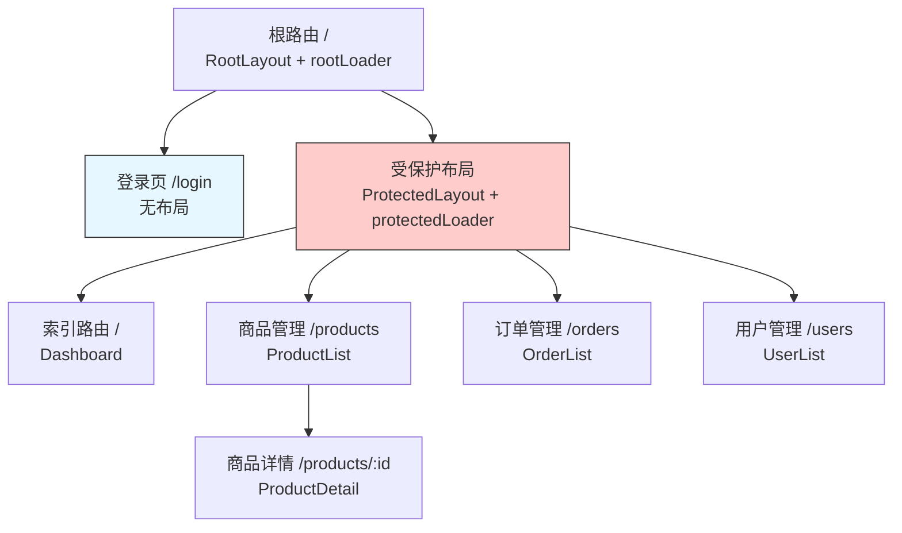
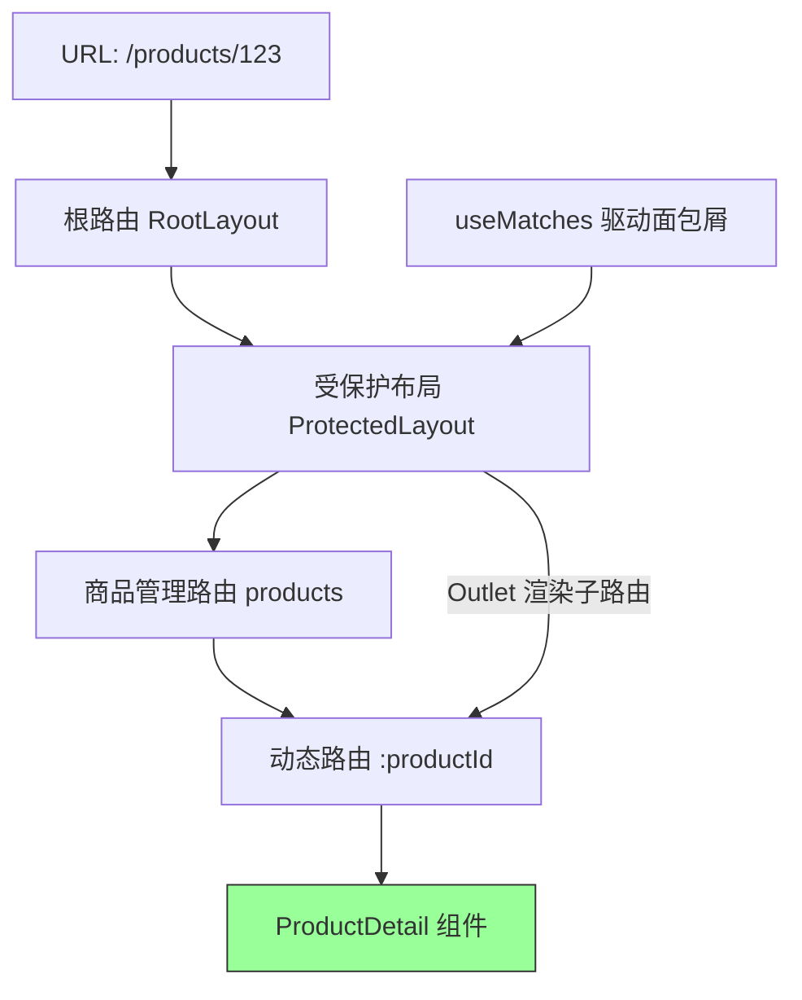
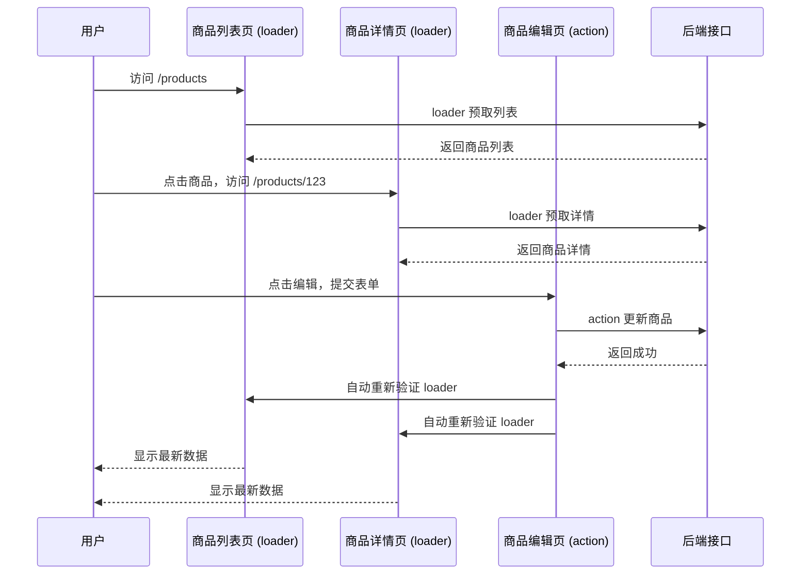
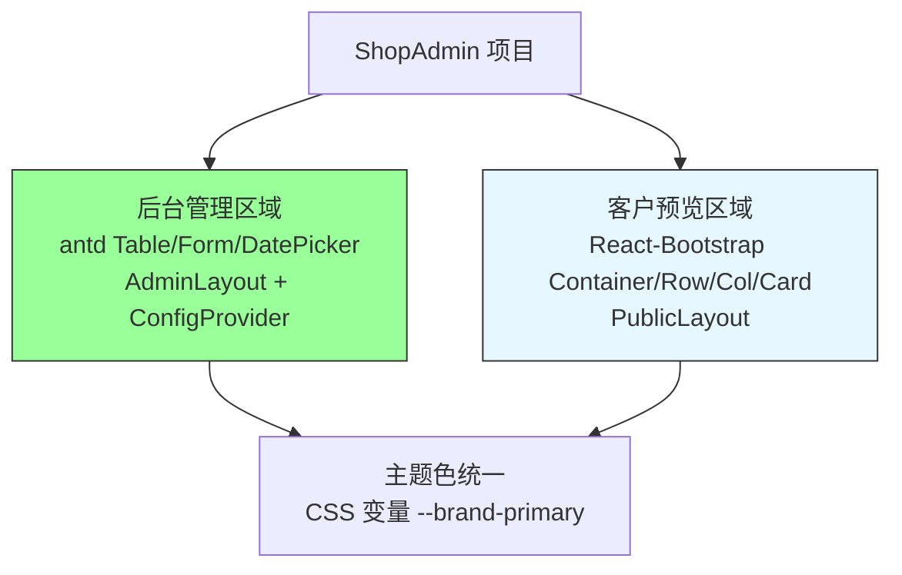
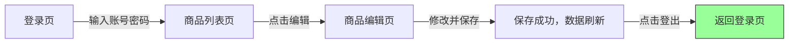

# 第9章 项目实战二：多页面应用（复杂路由与架构）

**本章概述**：本章聚焦多页面、多角色、多层级路由的复杂应用。选题为**电商后台管理系统（ShopAdmin）**：嵌套路由、loader/action 数据流、权限守卫、代码分割、React-Bootstrap 与 Ant Design 分区共存。我们会学习如何设计路由树、用嵌套布局和 Outlet 组合页面、用 loader/action 驱动数据流、用权限守卫保护路由、用路由级懒加载优化性能、用两套组件库分区共存，最后编写集成测试与 E2E 旅程。

**读者对象**：你已经读完了第1–8章，掌握了 React 组件、状态管理、路由、网络数据层、样式组件库和测试的基础，也完成了第一个 SPA 项目。本章是把路由和架构能力进一步深化的第二个完整项目。

---

## 9.1 需求分析与路由架构设计

### 项目选题：ShopAdmin 电商后台管理系统

ShopAdmin 是一个电商后台管理系统，核心功能包括：

- **商品管理**：商品列表、商品详情、商品创建、商品编辑
- **订单管理**：订单列表、订单详情、订单状态变更
- **用户管理**：用户列表、用户详情、角色分配
- **数据看板**：销售概览、图表展示

这是一个典型的多页面、多角色、多层级路由应用：不同模块嵌套在布局路由下，登录页不使用布局，受保护页面需要登录后才能访问。

### 路由树设计

梳理四大模块，画出路由树：

```
根布局路由（Layout）
├── 登录页（Login，无布局）
├── 受保护布局路由（ProtectedLayout，需登录）
│   ├── 数据看板（Dashboard，索引路由）
│   ├── 商品管理（Products）
│   │   ├── 商品列表（Products.List，索引路由）
│   │   └── 商品详情（Products.Detail，动态路由 :productId）
│   ├── 订单管理（Orders）
│   │   └── 订单列表（Orders.List）
│   └── 用户管理（Users）
│       └── 用户列表（Users.List）
```

**路由设计原则：**
- 根路由承载全局布局（顶栏、侧边栏）；
- 登录页不在布局内，独立渲染；
- 受保护页面嵌套在 `ProtectedLayout` 下，由 `loader` 做鉴权；
- 业务模块用嵌套路由，列表页是索引路由，详情页是动态路由。

### createBrowserRouter 的 RouteObject 树形结构

```tsx
// src/routes/router.tsx
import { createBrowserRouter } from 'react-router/dom'
import RootLayout from './layouts/RootLayout'
import ProtectedLayout from './layouts/ProtectedLayout'
import Login from './pages/Login'
import Dashboard from './pages/Dashboard'
import ProductList from './pages/products/ProductList'
import ProductDetail from './pages/products/ProductDetail'
import OrderList from './pages/orders/OrderList'
import UserList from './pages/users/UserList'
import { rootLoader } from './loaders/rootLoader'
import { protectedLoader } from './loaders/protectedLoader'

export const router = createBrowserRouter([
  {
    path: '/',
    element: <RootLayout />,
    loader: rootLoader, // 获取全局数据（导航菜单、用户信息等）
    children: [
      { path: 'login', element: <Login /> }, // 无布局，独立渲染
      {
        path: '',
        element: <ProtectedLayout />,
        loader: protectedLoader, // 鉴权：未登录重定向到 /login
        children: [
          { index: true, element: <Dashboard /> },
          {
            path: 'products',
            element: <ProductList />,
            children: [
              { index: true, element: <ProductList /> },
              { path: ':productId', element: <ProductDetail /> },
            ],
          },
          { path: 'orders', element: <OrderList /> },
          { path: 'users', element: <UserList /> },
        ],
      },
    ],
  },
])
```

关键点：
- `index: true` 表示索引路由，匹配父路径时渲染（比如 `/products` 渲染 `ProductList`）；
- `:productId` 表示动态路由参数，在组件里用 `useParams` 读取；
- 根路由的 `loader` 获取全局数据，受保护布局的 `loader` 做鉴权。

> **小结**：ShopAdmin 路由树采用“根布局 → 登录页（无布局）→ 受保护布局 → 各业务模块嵌套路由”的结构。`createBrowserRouter` 接收 `RouteObject` 数组，`index: true` 表示索引路由，`:productId` 表示动态参数。

#### 路由树结构示意图



---

## 9.2 嵌套布局与 Outlet 组合

### 用无路径布局路由承载侧边栏与顶栏

`ProtectedLayout` 是一个无路径布局路由（`path: ''`），不改变 URL，只负责渲染共享的布局UI。业务页面通过 `<Outlet>` 渲染在布局的内容区。

```tsx
// src/layouts/ProtectedLayout.tsx
import { Layout, Menu } from 'antd'
import { Outlet, useMatches } from 'react-router/dom'
import { useRouteLoaderData } from 'react-router/dom'

const { Sider, Header, Content } = Layout

type RootData = { user: { name: string; role: string }; menu: any[] }

export default function ProtectedLayout() {
  const data = useRouteLoaderData('root') as RootData
  const matches = useMatches()

  // 用 useMatches 驱动面包屑
  const breadcrumbs = matches
    .filter((m) => m.handle?.breadcrumb)
    .map((m) => m.handle!.breadcrumb!)

  return (
    <Layout>
      <Sider width={220}>
        <Menu mode="inline" defaultSelectedKeys={['1']} items={[
          { key: '1', label: '看板', icon: <DashboardOutlined /> },
          { key: '2', label: '商品', icon: <ShopOutlined /> },
          { key: '3', label: '订单', icon: <OrderOutlined /> },
          { key: '4', label: '用户', icon: <UserOutlined /> },
        ]} />
      </Sider>
      <Layout>
        <Header style={{ background: '#fff', padding: 0, display: 'flex', alignItems: 'center', justifyContent: 'space-between' }}>
          <div style={{ display: 'flex', alignItems: 'center', gap: 16, padding: 16 }}>
            <h2 style={{ margin: 0 }}>ShopAdmin</h2>
            {breadcrumbs.length > 0 && (
              <div style={{ fontSize: 14, color: '#666' }}>
                {breadcrumbs.map((b) => b.label).join(' > ')}
              </div>
            )}
          </div>
          <div style={{ padding: 16 }}>
            {data.user.name} ({data.user.role})
          </div>
        </Header>
        <Content style={{ padding: 24, background: '#f5f5f5', minHeight: 280 }}>
          <Outlet /> {/* 子路由页面渲染在这里 */}
        </Content>
      </Layout>
    </Layout>
  )
}
```

### useMatches 驱动面包屑，handle 字段传递路由元信息

`useMatches` 返回当前匹配的所有路由匹配项，每个匹配项可以包含 `handle` 字段（自定义元信息）。我们可以在路由配置里给每个路由加 `handle: { breadcrumb: { label: '商品列表' } }`，布局组件读取后渲染面包屑。

```tsx
// 路由配置中
{
  path: 'products',
  element: <ProductList />,
  handle: { breadcrumb: { label: '商品管理' } },
  children: [
    { index: true, element: <ProductList />, handle: { breadcrumb: { label: '商品列表' } } },
    { path: ':productId', element: <ProductDetail />, handle: { breadcrumb: { label: '商品详情' } } },
  ],
},
```

### 布局路由 + 索引路由 + 动态路由的组合模式

- **布局路由**：`ProtectedLayout`，渲染侧边栏、顶栏，`<Outlet>` 渲染子页面；
- **索引路由**：`index: true`，匹配父路径，如 `/products` 渲染商品列表；
- **动态路由**：`:productId`，匹配带参数的路径，如 `/products/123` 渲染商品详情，组件里用 `useParams()` 读取 `productId`。

```tsx
// 商品详情页
import { useParams } from 'react-router/dom'

function ProductDetail() {
  const { productId } = useParams<{ productId: string }>()
  // 用 productId 获取详情数据
}
```

> **小结**：无路径布局路由承载侧边栏与顶栏，业务页面通过 `<Outlet>` 渲染；`useMatches` 驱动面包屑，`handle` 字段传递路由元信息；布局路由 + 索引路由 + 动态路由的组合模式是多页面应用的标准结构。

#### 嵌套布局与 Outlet 渲染流程



---

## 9.3 loader/action 驱动的数据流

### 每个业务路由配置 loader 预取数据、action 处理表单提交

商品列表页的 `loader` 预取商品数据，商品编辑页的 `action` 处理表单提交，提交后自动重新验证 `loader`。

```tsx
// src/pages/products/ProductList.tsx
import { useLoaderData } from 'react-router/dom'
import { Table, Button, Space } from 'antd'
import { productApi } from '@/features/products/api'

type ProductListData = { products: any[]; total: number }

export const loader = async () => {
  const res = await productApi.getList()
  return res.data
}

export default function ProductListPage() {
  const { products } = useLoaderData() as ProductListData

  return (
    <div>
      <h1>商品列表</h1>
      <Table dataSource={products} rowKey="id" columns={[]} />
    </div>
  )
}
```

```tsx
// src/pages/products/ProductEdit.tsx
import { Form, useActionData, ActionFunctionArgs, redirect } from 'react-router/dom'
import { productApi } from '@/features/products/api'
import { useParams } from 'react-router/dom'

export const action = async ({ request, params }: ActionFunctionArgs) => {
  const formData = await request.formData()
  const title = formData.get('title')
  const price = formData.get('price')

  await productApi.update(params.id!, { title, price })
  return redirect('/products') // 提交成功后跳回列表页
}

export default function ProductEditPage() {
  const actionData = useActionData() as { error?: string } | undefined
  const { productId } = useParams<{ productId: string }>()

  return (
    <Form method="POST" layout="vertical">
      <Form.Item label="商品名" name="title">
        <input />
      </Form.Item>
      <Form.Item label="价格" name="price">
        <input type="number" />
      </Form.Item>
      {actionData?.error && <p style={{ color: 'red' }}>{actionData.error}</p>}
      <button type="submit">保存</button>
    </Form>
  )
}
```

### useNavigation 展示全局提交状态

```tsx
import { useNavigation } from 'react-router/dom'

function SubmittingIndicator() {
  const navigation = useNavigation()
  if (navigation.state === 'submitting') {
    return <div className="loading">保存中...</div>
  }
  return null
}
```

### useFetcher 实现行内编辑而不触发导航

行内编辑不需要跳转页面，只需要在当前页提交数据，用 `useFetcher`。

```tsx
import { useFetcher, Form } from 'react-router/dom'

function ProductRow({ product }) {
  const fetcher = useFetcher()

  return (
    <Form
      method="post"
      action={`/api/products/${product.id}`}
      onSubmit={(e) => {
        e.preventDefault()
        fetcher.submit(e.currentTarget, { method: 'post' })
      }}
    >
      <input name="title" defaultValue={product.title} />
      <button type="submit">保存</button>
      {fetcher.state === 'submitting' && <span>保存中...</span>}
    </Form>
  )
}
```

### 列表页 loader + 详情页 loader + 编辑 action 的完整闭环

1. 用户访问 `/products`，列表页 `loader` 预取商品列表；
2. 用户点击某个商品，跳转 `/products/123`，详情页 `loader` 预取商品详情；
3. 用户点击编辑，跳转 `/products/123/edit`，编辑页渲染表单；
4. 用户提交表单，触发 `action` 更新商品；
5. `action` 完成后，React Router 自动重新验证相关 `loader`（列表页和详情页），数据保持一致。

> **小结**：`loader` 预取数据，`action` 处理表单提交，提交后自动重新验证 `loader`。`useNavigation` 的 `state === 'submitting'` 展示全局提交状态，`useFetcher` 实现行内编辑而不触发导航。列表页 loader、详情页 loader、编辑 action 形成完整的数据流闭环。

#### loader/action 数据流闭环



---

## 9.4 权限守卫与受保护路由

### 根布局 loader 读取会话，未登录时 throw redirect("/login")

权限守卫的核心原则：**鉴权在 loader 层完成，而非组件内 useEffect。** 在 `ProtectedLayout` 的 `loader` 里读取会话（token、用户信息），如果未登录，抛出 `redirect('/login')`。

```tsx
// src/loaders/protectedLoader.ts
import { redirect } from 'react-router/dom'

export const protectedLoader = async () => {
  const token = localStorage.getItem('token')
  if (!token) {
    throw redirect('/login') // 未登录，重定向到登录页
  }
  const user = await fetchUser(token) // 获取用户信息
  return { user }
}
```

### 用角色字段在嵌套布局 loader 中做二级鉴权

除了登录鉴权，还可以根据角色做二级鉴权。比如只有 `admin` 角色才能访问用户管理页面：

```tsx
// src/loaders/usersLoader.ts
import { redirect } from 'react-router/dom'

export const usersLoader = async () => {
  const user = await getCurrentUser()
  if (user.role !== 'admin') {
    throw redirect('/unauthorized') // 无权限，重定向到无权限页面
  }
  return { users: await fetchUsers() }
}
```

### 登录 action 成功后重定向回原路径

登录成功后，应该把用户重定向回他本来想访问的页面，而不是固定跳到首页。可以用 URL 查询参数 `from` 记录原路径。

```tsx
// src/pages/Login.tsx
import { action, redirect } from 'react-router/dom'

export const loginAction = async ({ request }: ActionFunctionArgs) => {
  const formData = await request.formData()
  // 验证用户名密码...
  const from = formData.get('from') || '/'
  return redirect(from) // 登录成功后跳回原路径
}
```

路由配置里把 `from` 传递给登录页：

```tsx
{
  path: 'login',
  element: <Login />,
  // 登录页不需要布局，独立渲染
},
```

在未登录时重定向登录页，并带上 `from` 参数：

```tsx
throw redirect(`/login?from=${encodeURIComponent(location.pathname)}`)
```

> **小结**：受保护路由通过根布局 `loader` 读取会话，未登录时 `throw redirect("/login")`；用角色字段在嵌套布局 `loader` 中做二级鉴权；登录 `action` 成功后重定向回原路径（`redirect(params.get("from"))`）。鉴权在 loader 层完成，不在组件内用 `useEffect`。

#### 权限守卫流程

```mermaid
flowchart TD
    A[用户访问受保护页面] --> B[ProtectedLayout loader 执行]
    B --> C{有 token 会话？}
    C -- 否 --> D[throw redirect('/login?from=当前路径')]
    C -- 是 --> E{角色是否满足？}
    E -- 否 --> F[throw redirect('/unauthorized')]
    E -- 是 --> G[返回用户数据，渲染页面]
    D --> H[用户登录]
    H --> I[redirect(from)<br/>跳回原路径]
    I --> G
    style D fill:#ffcccc,stroke:#333
    style G fill:#99ff99,stroke:#333
```

---

## 9.5 代码分割与路由级懒加载

### 用 route.lazy 对每个业务模块做路由级代码分割

随着应用变大，把所有页面组件打进一个 bundle 会导致首屈加载慢。`route.lazy` 可以实现路由级代码分割：只有当用户真正访问该路由时，才下载对应的组件代码。

```tsx
export const router = createBrowserRouter([
  {
    path: '/',
    element: <RootLayout />,
    children: [
      { path: 'login', element: <Login /> },
      {
        path: '',
        element: <ProtectedLayout />,
        children: [
          { index: true, element: <Dashboard /> },
          {
            path: 'products',
            lazy: () => import('./pages/products/ProductListRoute'), // 按需加载
            children: [
              { index: true, lazy: () => import('./pages/products/ProductList') },
              { path: ':productId', lazy: () => import('./pages/products/ProductDetail') },
            ],
          },
          {
            path: 'orders',
            lazy: () => import('./pages/orders/OrderListRoute'),
          },
          {
            path: 'users',
            lazy: () => import('./pages/users/UserListRoute'),
          },
        ],
      },
    ],
  },
])
```

配合 `<Suspense>` 和加载骨架，用户在路由切换时能看到加载状态，而不是白屏：

```tsx
import { Suspense } from 'react'

function App() {
  return (
    <RouterProvider router={router}>
      <Suspense fallback={<div>加载中...</div>}>
        {/* 路由内容在这里渲染 */}
      </Suspense>
    </RouterProvider>
  )
}
```

### route.lazy 与 React.lazy 的区别

- `React.lazy`：组件级懒加载，配合 `<Suspense>` 在组件树内部使用；
- `route.lazy`：路由级懒加载，配置在路由对象里，React Router 会自动处理路由切换时的加载和 Suspense 集成。

### 拆分前后的 bundle 对比

拆分前：所有页面组件在一个 `index.js` 里，首屈需要下载所有代码。

拆分后：每个业务模块独立成 chunk，首屈只下载布局和首页，访问其他模块时再按需下载。可以用 `rollup-plugin-visualizer` 查看 bundle 分析报告，确认各模块是否独立成 chunk。

> **小结**：`route.lazy` 实现路由级代码分割，配合 `<Suspense>` 和加载骨架。`React.lazy` 是组件级懒加载，`route.lazy` 是路由级懒加载，由 React Router 自动集成。拆分后各业务模块独立成 chunk，首屈加载更快。

#### 路由级懒加载流程

```mermaid
flowchart TD
    A[用户访问 /products] --> B[React Router 匹配 route.lazy]
    B --> C[动态 import() 加载 ProductList 模块]
    C --> D[Suspense 显示加载骨架]
    D --> E[模块加载完成，渲染页面]
    F[用户访问 /orders] --> G[动态 import() 加载 OrderList 模块]
    G --> D
    style E fill:#99ff99,stroke:#333
    style D fill:#e6f7ff,stroke:#333
```

---

## 9.6 样式库分区共存：Ant Design + React-Bootstrap

### 后台数据界面用 antd，面向客户的商品预览页用 React-Bootstrap

ShopAdmin 主要是后台管理界面，用 Ant Design 的 `Table`、`Form`、`DatePicker` 处理数据密集型页面。但如果系统里有一些面向客户的轻量页面（比如商品预览、公告页），可以用 React-Bootstrap 的 `Container`、`Row`、`Col`、`Card`。

```tsx
// 后台商品列表：用 antd Table
import { Table, Button, Card } from 'antd'

// 客户商品预览：用 React-Bootstrap Card
import { Card, Container, Row, Col } from 'react-bootstrap'
```

### 目录隔离与 ConfigProvider token 桥接避免设计语言冲突

为了避免两套设计语言在同一屏内混用，按功能区域做目录隔离：

```
src/
  ├── features/
  │   ├── admin/          # 后台区域，只用 antd
  │   └── public/         # 面向客户区域，只用 React-Bootstrap
  ├── layouts/
  │   ├── AdminLayout.tsx  # 用 antd Layout + ConfigProvider
  │   └── PublicLayout.tsx # 用 React-Bootstrap Container
```

主题色统一：用 CSS 变量桥接。在 `ConfigProvider` 的 `token` 里定义主色，React-Bootstrap 的按钮也用同样的 CSS 变量。

```css
:root {
  --brand-primary: #1677ff;
}
```

```tsx
// Ant Design 主题
<ConfigProvider theme={{ token: { colorPrimary: 'var(--brand-primary)' } }}>
```

```css
/* React-Bootstrap 覆盖 */
.btn-primary {
  background-color: var(--brand-primary);
  border-color: var(--brand-primary);
}
```

> **小结**：后台数据界面用 antd（`Table`、`Form`、`DatePicker`），面向客户的商品预览页用 React-Bootstrap（`Container`、`Row`、`Col`、`Card`）。通过目录隔离与 `ConfigProvider` token 桥接，避免两套设计语言冲突。

#### 样式库分区共存



---

## 9.7 集成测试与 E2E 旅程

### 用 createMemoryRouter + MSW 测试 loader 鉴权重定向、action 提交后重新验证

```tsx
// src/pages/products/ProductList.test.tsx
import { render, screen } from '@testing-library/react'
import { RouterProvider } from 'react-router/dom'
import { createMemoryRouter } from 'react-router/dom'
import { server } from '@/mocks/server'
import { productListRoute } from './productListRoute'

test('未登录访问商品列表应重定向到登录页', async () => {
  // MSW 拦截 /api/session 返回 401
  server.use(
    http.get('/api/session', () => new HttpResponse(null, { status: 401 }))
  )

  const router = createMemoryRouter([
    {
      path: '/',
      element: <ProtectedLayout />,
      loader: protectedLoader, // 会抛出 redirect('/login')
      children: [{ path: 'products', element: <ProductList /> }],
    },
  ], {
    initialEntries: ['/products'],
  })

  render(
    <RouterProvider router={router}>
      <ProductList />
    </RouterProvider>
  )

  expect(await screen.findByRole('heading', { name: /登录/i })).toBeInTheDocument()
})

test('action 提交后应重新验证 loader 数据', async () => {
  // 模拟商品更新成功
  server.use(
    http.put('/api/products/:id', () => HttpResponse.json({ success: true }))
  )

  const router = createMemoryRouter([
    {
      path: '/products/:id/edit',
      element: <ProductEdit />,
      action: productEditAction,
      loader: productEditLoader,
    },
  ], {
    initialEntries: ['/products/1/edit'],
  })

  render(
    <RouterProvider router={router}>
      <ProductEdit />
    </RouterProvider>
  )

  await user.click(screen.getByRole('button', { name: /保存/ }))
  // 验证页面跳转回列表，或重新获取了数据
  expect(await screen.findByText('/products')).toBeInTheDocument()
})
```

### 用 Playwright 覆盖“登录→商品列表→编辑→保存→登出”完整旅程

```tsx
// e2e/shop-admin.spec.ts
import { test, expect } from '@playwright/test'

test('登录 → 商品列表 → 编辑 → 保存 → 登出 完整旅程', async ({ page }) => {
  // 1. 打开登录页
  await page.goto('http://localhost:5173/login')

  // 2. 登录
  await page.getByLabelText(/用户名/i).fill('admin')
  await page.getByLabelText(/密码/i).fill('123456')
  await page.getByRole('button', { name: /登录/ }).click()
  await expect(page.getByText('欢迎，admin')).toBeVisible()

  // 3. 进入商品列表
  await page.getByRole('button', { name: /商品管理/ }).click()
  await expect(page.getByText('商品列表')).toBeVisible()

  // 4. 编辑商品
  await page.getByRole('button', { name: /编辑/, exact: true }).first().click()
  await page.getByLabelText(/商品名/i).fill('更新后的商品名')
  await page.getByRole('button', { name: /保存/ }).click()

  // 5. 验证保存成功
  await expect(page.getByText('更新后的商品名')).toBeVisible()

  // 6. 登出
  await page.getByRole('button', { name: /登出/ }).click()
  await expect(page.getByRole('heading', { name: /登录/i })).toBeVisible()
})
```

> **小结**：用 `createMemoryRouter` + MSW 测试 loader 鉴权重定向、action 提交后重新验证；用 Playwright 覆盖“登录→商品列表→编辑→保存→登出”完整旅程。

#### E2E 完整旅程



---

## 本章小结

第9章是第二个完整项目实战，我们构建了 ShopAdmin 电商后台管理系统：

1. **需求分析与路由架构设计**：梳理商品、订单、用户、看板四大模块，画出路由树，用 `createBrowserRouter` 配置 `RouteObject` 树形结构。
2. **嵌套布局与 Outlet 组合**：用无路径布局路由承载侧边栏与顶栏，`useMatches` 驱动面包屑，`handle` 字段传递元信息，布局路由 + 索引路由 + 动态路由组合。
3. **loader/action 驱动的数据流**：每个业务路由配置 `loader` 预取数据、`action` 处理表单提交，提交后自动重新验证 `loader`；`useNavigation` 展示提交状态，`useFetcher` 实现行内编辑。
4. **权限守卫与受保护路由**：根布局 `loader` 读取会话，未登录 `throw redirect('/login')`；角色字段做二级鉴权；登录后重定向回原路径。
5. **代码分割与路由级懒加载**：`route.lazy` 对每个业务模块做代码分割，配合 `<Suspense>` 和加载骨架。
6. **样式库分区共存**：后台用 antd，客户预览页用 React-Bootstrap，目录隔离与 `ConfigProvider` token 桥接。
7. **集成测试与 E2E 旅程**：`createMemoryRouter` + MSW 测试鉴权和重新验证，Playwright 覆盖完整用户旅程。

下一章是 React Native 移动端，学习 Expo、Expo Router、NativeWind 等移动端技术。