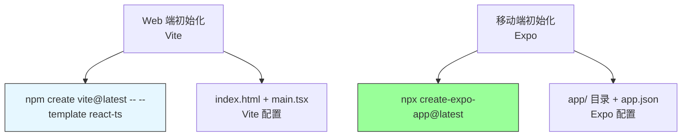
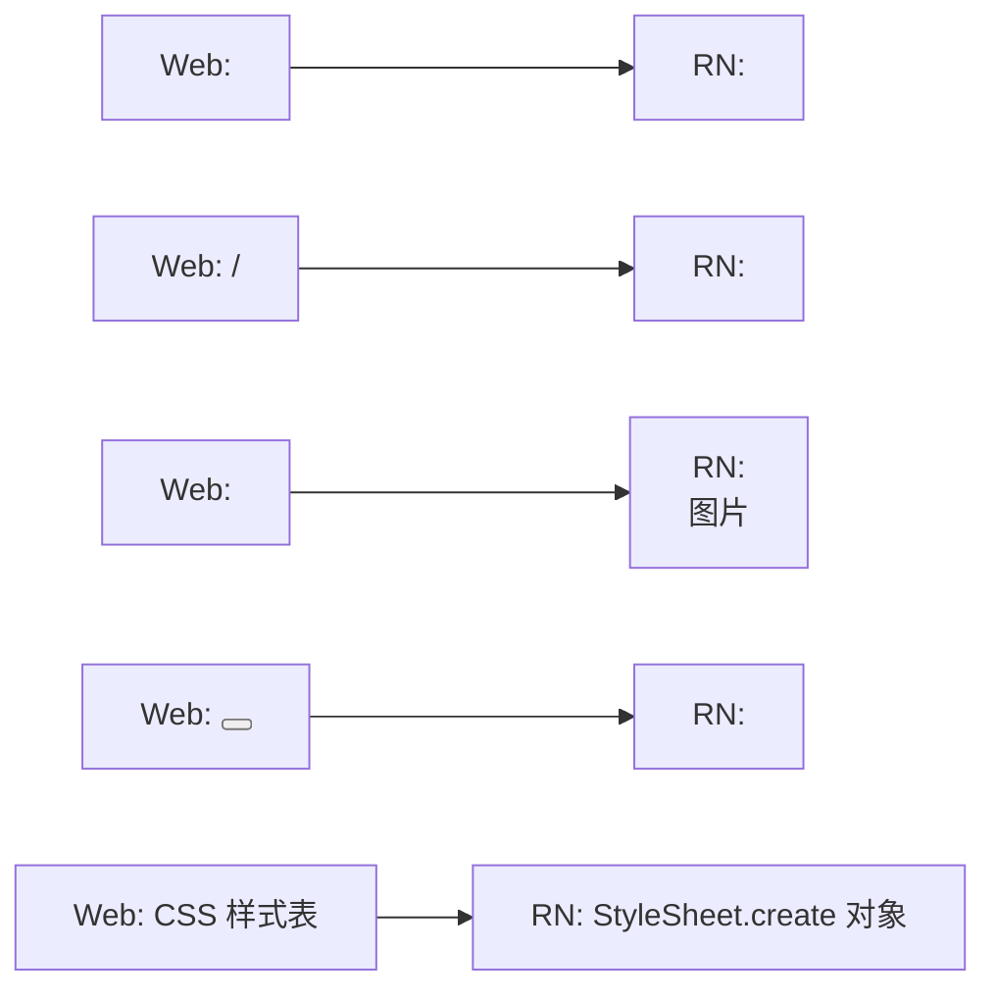
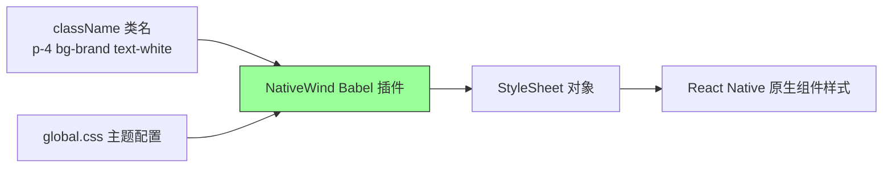
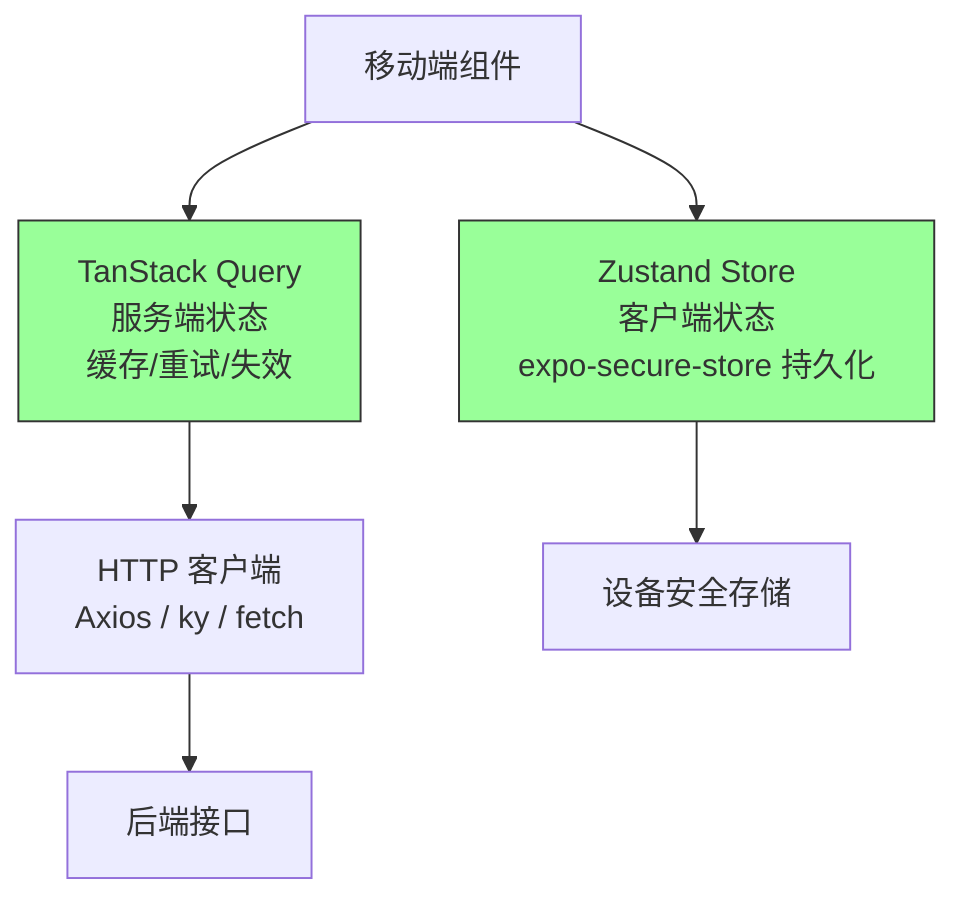
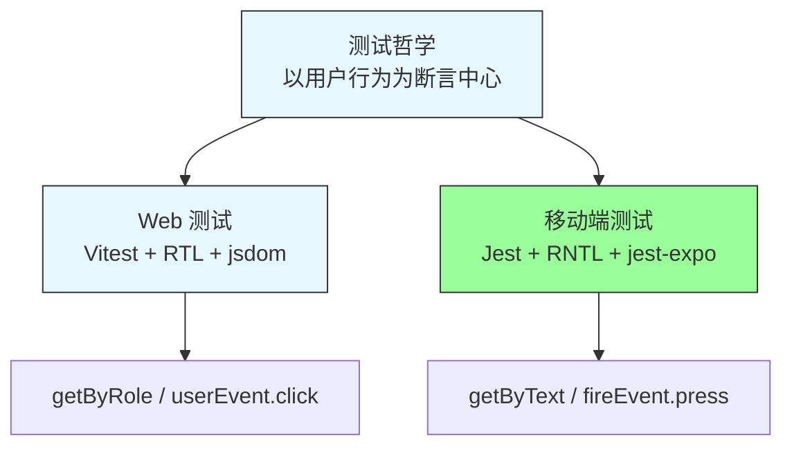

# 第10章 React Native 移动端

**本章概述**：React Native 让你用 React 的思维构建原生移动应用。本章我们学习 React Native 移动端开发的核心：用 Expo 初始化项目、认识 View/Text/Image/Pressable 等核心组件、用 Expo Router 做文件式导航、用 NativeWind 写 Tailwind 样式、用 Zustand + TanStack Query 管理状态与数据、用 React Native Testing Library 做测试。

**读者对象**：你已经读完了第1–9章，掌握了 React Web 开发的组件、状态、路由、网络和测试。如果你以前只做过 Web 前端，本章会帮你建立“从 Web DOM 到 React Native 原生组件”的映射关系。

---

## 10.1 Expo 与项目初始化：移动端的标准起点

### 什么是 Expo？

React Native 原生开发需要配置 Xcode、Android Studio、Gradle 等原生工具链，配置过程复杂。Expo 是围绕 React Native 构建的框架和平台，它封装了原生代码，让你只用 JavaScript/TypeScript 就能开发、构建、发布移动应用，无需碰原生代码。

**React Native 的推荐起点已是 Expo + SDK 52+（新架构 Fabric/TurboModules 默认启用）**，`npx create-expo-app@latest` 是标准初始化命令。

### 初始化 Expo 项目

```bash
npx create-expo-app@latest my-mobile-app
cd my-mobile-app
npx expo install expo-router
npx expo start
```

执行 `npx expo start` 后，终端会显示一个二维码，用 Expo Go App（手机应用）扫码就能在真机上预览，也可以按 `w` 在网页预览，按 `a` 在 Android 模拟器，按 `i` 在 iOS 模拟器。

### Expo 项目结构

```
my-mobile-app/
├── app/               # Expo Router 文件式路由目录
├── components/        # 公共组件
├── assets/            # 图片、字体等静态资源
├── app.json           # Expo 项目配置（应用名、图标、权限等）
├── package.json
└── babel.config.js    # Babel 配置
```

与第1章 Vite 项目的对照：
- Vite 项目的入口是 `index.html` + `main.tsx`；
- Expo 项目的入口是 `app/_layout.tsx` + `app/index.tsx`，由 Expo Router 自动管理。

### 开发构建与生产构建

- **开发构建**：`npx expo start`，启动开发服务器，支持热更新；
- **生产构建**：`npx expo build` 或 EAS Build（`npx eas build`），生成 Android APK/AAB 或 iOS IPA，可上架应用商店。

> **小结**：React Native 的推荐起点是 Expo + SDK 52+`npx create-expo-app@latest` 是标准初始化命令。Expo 封装了原生工具链，无需配置 Xcode/Android Studio，扫码即可在真机预览。

#### Expo 与 Vite 初始化对照



---

## 10.2 核心组件与布局：View、Text、Image、Pressable

### 移动端 UI 基元与 Web 的不同

React Native 没有 `<div>`、`<span>`、`<p>` 等 HTML 标签，而是提供自己的一套原生组件。移动端 UI 基元与 Web 的映射关系如下：

| Web 元素 | React Native 组件 | 说明 |
|---------|------------------|------|
| `<div>` | `<View>` | 容器，默认 `flexDirection: column` |
| `<span>` / `<p>` | `<Text>` | 必须包裹所有文本，文本不能直接放在 View 里 |
| `` | `<Image>` | 显示图片 |
| `<button>` / `div onClick` | `<Pressable>` | 按钮或可点击区域 |
| `<ul>` / 列表 | `<FlatList>` / `<ScrollView>` | 列表或滚动容器 |
| CSS 样式 | `StyleSheet.create` | 用对象而非 CSS 字符串定义样式 |

### 核心组件示例

```tsx
// app/index.tsx
import { View, Text, Image, Pressable, ScrollView, StyleSheet } from 'react-native'

export default function HomeScreen() {
  return (
    <View style={styles.container}>
      <Image source={{ uri: 'https://example.com/logo.png' }} style={styles.logo} />
      <Text style={styles.title}>你好，React Native</Text>
      <ScrollView>
        <Pressable style={styles.button} onPress={() => {}}>
          <Text>点击我</Text>
        </Pressable>
      </ScrollView>
    </View>
  )
}

const styles = StyleSheet.create({
  container: {
    flex: 1,
    backgroundColor: '#fff',
    padding: 16,
  },
  logo: {
    width: 100,
    height: 100,
    alignSelf: 'center',
  },
  title: {
    fontSize: 24,
    fontWeight: 'bold',
    marginTop: 20,
  },
  button: {
    backgroundColor: '#007aff',
    padding: 12,
    borderRadius: 8,
    marginTop: 16,
    alignItems: 'center',
  },
})
```

### 关键注意点

1. **`View` 是 flex 容器，默认 `flexDirection: column`**：与 Web 默认的 `row` 不同，移动端子组件默认竖向排列；
2. **`Text` 必须包裹所有文本**：在 React Native 里，文本不能直接放在 `<View>` 里，必须用 `<Text>` 包裹，否则会报错；
3. **`Pressable` 替代 `div onClick`**：处理点击事件，支持 `onPress`、`onLongPress` 等；
4. **样式用 `StyleSheet`**：用 JavaScript 对象定义样式，属性名用 camelCase（如 `backgroundColor`、`fontSize`），不支持 CSS 选择器和媒体查询。

> **小结**：移动端 UI 基元与 Web 不同：`View` 是 flex 容器（默认 `flexDirection: column`），`Text` 必须包裹所有文本，`Pressable` 替代 `div onClick`。样式用 `StyleSheet.create` 定义对象，不写 CSS 字符串。

#### 从 Web DOM 到 RN 组件映射



---

## 10.3 Expo Router：文件式导航与 Stack/Tabs

### 什么是 Expo Router？

Expo Router v4+ 提供基于文件的路由，**目录结构即路由结构**。你不需要手动写路由配置，把页面文件放到 `app/` 目录下，文件名和目录层级就是路由路径。

### 基本用法

```
app/
  ├── _layout.tsx        # 根布局，配置 Stack 或 Tabs
  ├── index.tsx          # 路径 /
  ├── settings.tsx       # 路径 /settings
  ├── (tabs)/            # 标签栏分组
  │   ├── _layout.tsx    # 标签栏布局
  │   ├── index.tsx      # 路径 / (底部标签页)
  │   └── profile.tsx    # 路径 /profile
  └── habit/[id].tsx     # 动态路由，路径 /habit/:id
```

### `<Stack>`、`<Tabs>` 与 `<Link>`

```tsx
// app/_layout.tsx - 根布局，使用 Stack 导航
import { Stack } from 'expo-router'
import { NavigationContainer } from '@react-navigation/native'

export default function RootLayout() {
  return (
    <Stack>
      <Stack.Screen name="index" options={{ title: '首页' }} />
      <Stack.Screen name="settings" options={{ title: '设置' }} />
    </Stack>
  )
}
```

```tsx
// app/(tabs)/_layout.tsx - 底部标签栏
import { Tabs } from 'expo-router'

export default function TabsLayout() {
  return (
    <Tabs>
      <Tabs.Screen name="index" options={{ title: '今日', tabBarIcon: () => <HomeIcon /> }} />
      <Tabs.Screen name="stats" options={{ title: '统计', tabBarIcon: () => <ChartIcon /> }} />
      <Tabs.Screen name="settings" options={{ title: '设置', tabBarIcon: () => <SettingsIcon /> }} />
    </Tabs>
  )
}
```

### 路由跳转与参数

```tsx
import { Link, useRouter, useLocalSearchParams } from 'expo-router'

// 声明式跳转
<Link href="/habit/123">查看习惯</Link>

// 命令式跳转
const router = useRouter()
router.push('/habit/123')

// 读取动态路由参数
const { id } = useLocalSearchParams<{ id: string }>()
```

> **小结**：Expo Router v4+ 提供基于文件的路由，目录结构即路由结构。`_layout.tsx` 配置 Stack 或 Tabs，`(tabs)/` 分组定义底部标签栏，`[id].tsx` 为动态路由。用 `Link`、`useRouter`、`useLocalSearchParams` 进行导航和读取参数。

#### Expo Router 路由结构

```mermaid
flowchart TD
    A[app/ 目录] --> B[_layout.tsx 根布局 Stack]
    A --> C[index.tsx 路径 /]
    A --> D[(tabs)/ 标签栏分组]
    D --> D1[_layout.tsx 底部标签栏]
    D --> D2[index.tsx 路径 /]
    D --> D3[settings.tsx 路径 /settings]
    A --> E[[id].tsx 动态路由 /habit/:id]
    B --> C
    B --> D
    B --> E
```

---

## 10.4 样式：NativeWind v4（Tailwind for RN）

### 什么是 NativeWind？

NativeWind v4 将 Tailwind CSS 的类名语法带入 React Native，通过 Babel 插件与全局 CSS 配置启用。你可以直接在 RN 组件上使用 `className="p-4 bg-blue-500 text-white"` 这样的类名，不再需要为每个样式写 `StyleSheet.create`。

### 安装与配置

```bash
npx expo install nativewind tailwindcss
npx expo install --dev nativewind/babel
```

在 `babel.config.js` 中添加插件：

```js
module.exports = function (api) {
  api.cache(true)
  return {
    presets: ['babel-preset-expo'],
    plugins: ['nativewind/babel'],
  }
}
```

创建 `global.css`：

```css
@import 'nativewind/momentum.css';
@theme {
  --color-brand: #007aff;
}
```

在入口文件引入：

```tsx
// app/_layout.tsx
import 'nativewind/global.css'
```

### 在 RN 组件上使用 className

```tsx
import { View, Text, Pressable } from 'react-native'

export default function Button() {
  return (
    <Pressable
      className="bg-brand p-4 rounded-lg text-white flex items-center justify-center"
      onPress={() => {}}
    >
      <Text className="font-bold text-center">点击我</Text>
    </Pressable>
  )
}
```

### className 的使用限制

不是所有 RN 组件都直接支持 `className`。只有经过 NativeWind 处理的组件（如 `View`、`Text`、`Pressable`、`ScrollView` 等原生组件）才能直接使用。对于第三方组件，可能需要用 `StyleSheet` 或 `cn()` 工具函数结合条件样式。

### 与 StyleSheet 的混合策略

复杂动画或需要动态计算的样式，仍可用 `StyleSheet`；常规布局和静态样式用 `className`。两者可以混合使用：

```tsx
<View className="p-4" style={{ height: dynamicHeight }}>
  <Text className="text-center font-bold">内容</Text>
</View>
```

### 响应式前缀在移动端的实际含义

Tailwind 的响应式前缀（如 `sm:`, `md:`, `lg:`）在移动端的实际含义与 Web 不同。移动端屏幕宽度通常都在 `sm` 范围内，所以响应式前缀主要用于区分手机竖屏/横屏、平板等不同设备宽度，而非 Web 那种桌面/平板/手机的断点。

> **小结**：NativeWind v4 将 Tailwind 类名语法带入 React Native，通过 Babel 插件与 `global.css` 启用。`className` 在 RN 原生组件上直接使用，复杂动画可用 `StyleSheet` 混合。移动端响应式前缀主要区分设备宽度，而非 Web 的桌面/平板/手机断点。

#### NativeWind 样式应用



---

## 10.5 移动端状态与数据层：Zustand + TanStack Query 的复用

### 客户端状态继续用 Zustand

移动端的客户端状态（如用户偏好、当前选中的标签、本地草稿）继续用 Zustand 管理，心智模型与 Web 端完全一致：

```tsx
// store/useUserStore.ts
import { create } from 'zustand'
import { persist } from 'zustand/middleware'
import { createJSONStorage } from 'zustand/middleware'
import * as SecureStore from 'expo-secure-store'

interface UserState {
  token: string | null
  setToken: (token: string | null) => void
}

export const useUserStore = create<UserState>()(
  persist(
    (set) => ({
      token: null,
      setToken: (token) => set({ token }),
    }),
    {
      name: 'user-storage',
      storage: createJSONStorage(() => SecureStore), // 移动端用安全存储
    }
  )
)
```

注意：移动端没有 `localStorage`，安全存储使用 `expo-secure-store` 替代。Zustand 的 `persist` 中间件支持自定义 storage 适配器，传入 `expo-secure-store` 即可。

### 服务端状态继续用 TanStack Query

服务端状态（接口数据、缓存、轮询、失效重试）继续用 TanStack Query 管理，心智模型与 Web 端完全一致：

```tsx
// hooks/useHabits.ts
import { useQuery } from '@tanstack/react-query'
import { habitApi } from '@/lib/api'

export function useHabits() {
  return useQuery({
    queryKey: ['habits'],
    queryFn: habitApi.getList,
  })
}
```

### 安全存储：expo-secure-store 替代 localStorage

移动端没有浏览器的 `localStorage`，敏感数据（如 token、用户偏好）应使用 `expo-secure-store`，它会将数据加密存储在设备的安全区域（iOS Keychain / Android Keystore）。

```tsx
import * as SecureStore from 'expo-secure-store'

await SecureStore.setItemAsync('token', 'abc123')
const token = await SecureStore.getItemAsync('token')
await SecureStore.deleteItemAsync('token')
```

### expo-image 优化图片加载

移动端图片加载比 Web 更敏感，建议用 `expo-image` 替代原生 `<Image>`，它支持缓存、占位符、渐进式加载等优化。

```tsx
import { Image } from 'expo-image'

<Image
  src={{ uri: 'https://example.com/avatar.png' }}
  placeholder={{ uri: 'https://example.com/placeholder.png' }}
  cachePolicy="memory-only"
/>
```

> **小结**：移动端客户端状态继续用 Zustand，服务端状态继续用 TanStack Query，心智模型与 Web 端完全一致。安全存储使用 `expo-secure-store` 替代 `localStorage`，图片加载可用 `expo-image` 优化。

#### 移动端状态与数据层架构



---

## 10.6 移动端测试：RNTL 与第7章方法的复用

### React Native Testing Library (RNTL)

React Native Testing Library（RNTL）与 React Testing Library 共享“以用户行为为断言中心”的哲学，但查询 API 针对原生组件做了适配。例如，RN 中没有 `getByRole('button')` 这种 Web 的 ARIA 查询，而是用 `getByText`、`getByA11yLabel`、`getByA11yRole` 等。

```tsx
// __tests__/Counter.test.tsx
import { render, fireEvent } from '@testing-library/react-native'
import { Counter } from '../components/Counter'

test('计数器点击后增加', () => {
  const { getByText, getByTitle } = render(<Counter />)

  const button = getByTitle('增加')
  fireEvent.press(button)

  expect(getByText('当前计数：1')).toBeTruthy()
})
```

### Jest + RNTL 测试移动端页面

移动端测试通常用 Jest 作为测试运行器，配合 `jest-expo` 预置 Expo 环境。

```json
// package.json
{
  "jest": {
    "preset": "jest-expo",
    "transformIgnorePatterns": [
      "node_modules/(?!((react-native|react-native-universal|@react-native|react-native-reanimated)/.*)"
    ]
  }
}
```

### 与第7章 Web 测试的差异边界

| 比较项 | Web 测试 | 移动端测试 |
|--------|---------|-----------|
| 测试运行器 | Vitest | Jest |
| 组件测试库 | React Testing Library | React Native Testing Library |
| 查询方式 | `getByRole`、`getByLabelText` | `getByText`、`getByA11yLabel`、`getByA11yRole` |
| 交互模拟 | `userEvent.click` | `fireEvent.press` |
| 渲染 | `render(<Component />)` | `render(<Component />)` |
| 环境 | jsdom | jest-expo |

差异边界：Web 测试关注 DOM 元素和浏览器事件，移动端测试关注原生组件和触摸事件；Web 有路由和浏览器 API，移动端有原生模块和设备权限；两者共享“以用户行为为断言中心”的核心哲学。

> **小结**：RNTL 与 RTL 共享以用户行为为断言中心的哲学，但查询 API 针对原生组件适配。移动端测试用 Jest + RNTL，配合 `jest-expo` 预置环境。与 Web 测试的差异在于查询方式、交互模拟和测试环境。

#### 移动端测试与 Web 测试对照



---

## 本章小结

本章我们学习了 React Native 移动端开发的核心：

1. **Expo 初始化**：React Native 的推荐起点是 Expo + SDK 52+，`npx create-expo-app@latest` 是标准命令，无需配置 Xcode/Android Studio，扫码即可预览。
2. **核心组件**：`View` 是 flex 容器（默认 `flexDirection: column`），`Text` 必须包裹所有文本，`Pressable` 替代 `div onClick`，样式用 `StyleSheet.create`。
3. **Expo Router**：文件式导航，目录结构即路由结构。`_layout.tsx` 配置 Stack 或 Tabs，`(tabs)/` 分组定义底部标签栏，`[id].tsx` 为动态路由。
4. **NativeWind v4**：将 Tailwind 类名语法带入 RN，通过 Babel 插件与 `global.css` 启用，`className` 在原生组件上直接使用。
5. **状态与数据层**：客户端状态用 Zustand，服务端状态用 TanStack Query，心智模型与 Web 端一致。安全存储用 `expo-secure-store` 替代 `localStorage`，图片加载用 `expo-image`。
6. **移动端测试**：Jest + RNTL，查询 API 针对原生组件适配（`getByText`、`fireEvent.press`），与 Web 测试共享以用户行为为断言中心的哲学。

下一章是项目实战三：移动端应用，把第10章的知识收束为一个可上架的习惯打卡应用。