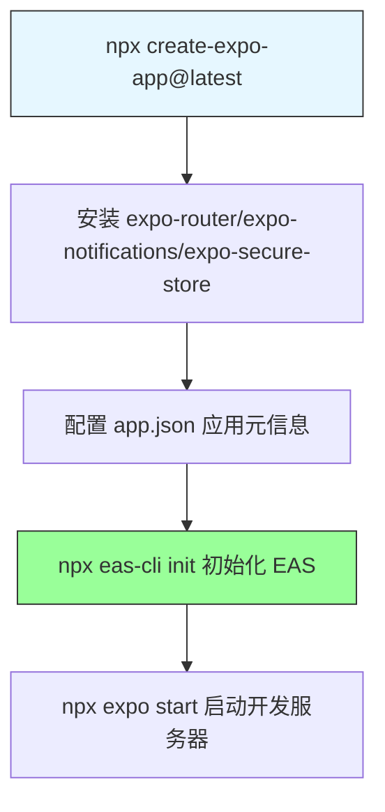
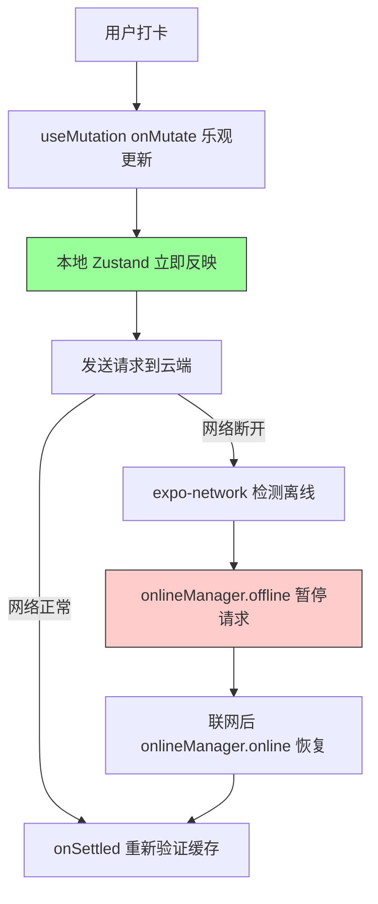
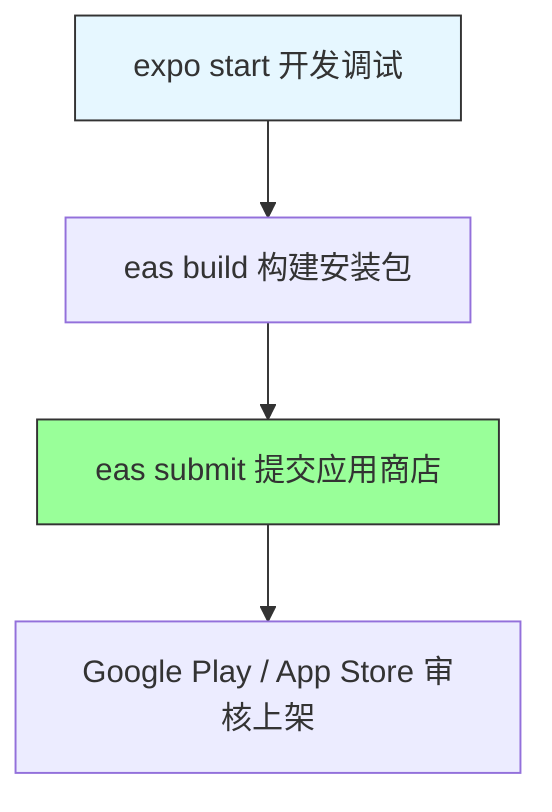

# 第11章 项目实战三：移动端应用

**本章概述**：本章把第10章的移动端知识收束为一个可上架的应用。选题为**习惯打卡应用（HabitLoop）**：Expo Router 文件式导航、NativeWind 样式、Zustand 本地状态、TanStack Query 同步云端、本地通知与安全存储。我们会从需求分析、Expo 项目初始化开始，逐步搭建文件式路由与 Tabs 导航、NativeWind 样式与组件封装、Zustand + 安全存储的本地状态、TanStack Query 云端同步与离线策略、本地通知、测试与 EAS 构建。

**读者对象**：你已经读完了第1–10章，掌握了 React Native 移动端开发的核心。本章是把移动端知识串联起来的第三个完整项目。

---

## 11.1 需求分析与 Expo 项目初始化

### 项目选题：HabitLoop 习惯打卡应用

HabitLoop 是一个习惯打卡移动应用，核心功能包括：

- **习惯创建**：创建自定义习惯（如“早起”、“阅读”、“运动”）
- **每日打卡**：每天对习惯进行打卡，记录打卡日期
- **连续天数统计**：计算并展示当前连续打卡天数
- **本地提醒**：每日固定时间发送本地通知提醒打卡
- **云端同步**：打卡数据同步到云端，多设备数据一致

### 功能边界与技术选型

| 模块 | 技术选型 | 理由 |
|------|---------|------|
| 导航 | Expo Router 文件式路由 | 目录结构即路由结构，开发效率高 |
| 样式 | NativeWind v4 | Tailwind 类名语法，上手快 |
| 本地状态 | Zustand + expo-secure-store | 轻量，敏感数据安全持久化 |
| 服务端状态 | TanStack Query | 缓存、重试、离线策略 |
| 本地通知 | expo-notifications | 系统级推送通知 |
| 构建与分发 | EAS Build | 生成 Android/iOS 安装包 |

### 初始化项目

```bash
npx create-expo-app@latest habit-loop
cd habit-loop
npx expo install expo-router expo-notifications expo-secure-store expo-network
npx expo install --dev nativewind tailwindcss nativewind/babel
npm install zustand @tanstack/react-query
npm install -D @testing-library/react-native jest jest-expo
npx expo start
```

### app.json 与 EAS 项目配置

`app.json` 是 Expo 项目的配置文件，包含应用名称、图标、权限、平台设置等：

```json
{
  "expo": {
    "name": "HabitLoop",
    "slug": "habit-loop",
    "version": "1.0.0",
    "orientation": "portrait",
    "icon": "./assets/icon.png",
    "userInterfaceStyle": "automatic",
    "splash": {
      "image": "./assets/splash.png",
      "resizeMode": "contain",
      "backgroundColor": "#ffffff"
    },
    "ios": {
      "bundleIdentifier": "com.example.habitloop",
      "usesUserNotifications": true
    },
    "android": {
      "package": "com.example.habitloop",
      "permissions": [],
      "googleServicesFile": "./google-services.json"
    },
    "plugins": [
      [
        "expo-notifications",
        {
          "permissions": ["NOTIFICATIONS"]
        }
      ]
    ]
  }
}
```

EAS（Expo Application Services）是 Expo 提供的云端构建与分发服务。初始化 EAS 项目：

```bash
npx eas-cli init
```

这会生成 `eas.json` 配置文件，用于配置构建配置文件（development、production 等）。

### Expo 与裸 React Native 的选型对照

| 维度 | Expo（托管工作流） | 裸 React Native |
|------|------------------|----------------|
| 原生代码 | 无需碰，由 Expo 管理 | 需要配置 Xcode/Android Studio |
| 原生模块 | 仅限 Expo 支持的模块 | 可任意集成原生代码 |
| 构建 | EAS Build 云端构建 | 本地 Xcode/Gradle 构建 |
| 适用场景 | 大多数移动应用 | 需要深度原生定制的场景 |

HabitLoop 采用 Expo 托管工作流，足以覆盖习惯打卡应用的所有功能。

> **小结**：HabitLoop 习惯打卡应用采用 Expo 初始化，`app.json` 配置应用元信息与权限，EAS CLI 用于云端构建与分发。Expo 托管工作流适合大多数移动应用，无需裸 React Native。

#### 项目初始化流程



---

## 11.2 文件式路由与 Tabs 导航

### 用 (tabs)/_layout.tsx 定义标签页

HabitLoop 有三个主要标签页：今日、统计、设置。用 Expo Router 的 `(tabs)/` 分组定义底部标签栏。

```
app/
  ├── _layout.tsx           # 根布局 Stack
  ├── index.tsx             # 今日（索引路由）
  ├── stats.tsx             # 统计
  ├── settings.tsx          # 设置
  ├── habit/[id].tsx        # 习惯详情动态路由
  └── (tabs)/
      ├── _layout.tsx       # 标签栏布局
      ├── index.tsx         # 今日标签页
      └── settings.tsx      # 设置标签页
```

```tsx
// app/(tabs)/_layout.tsx
import { Tabs } from 'expo-router'
import { Ionicons } from '@expo/vector-icons'

export default function TabsLayout() {
  return (
    <Tabs>
      <Tabs.Screen
        name="index"
        options={{
          title: '今日',
          tabBarIcon: ({ focused, color }) => (
            <Ionicons name={focused ? 'home' : 'home-outline'} size={28} color={color} />
          ),
        }}
      />
      <Tabs.Screen
        name="stats"
        options={{
          title: '统计',
          tabBarIcon: ({ focused, color }) => (
            <Ionicons name={focused ? 'stats-chart' : 'stats-chart-outline'} size={28} color={color} />
          ),
        }}
      />
      <Tabs.Screen
        name="settings"
        options={{
          title: '设置',
          tabBarIcon: ({ focused, color }) => (
            <Ionicons name={focused ? 'settings' : 'settings-outline'} size={28} color={color} />
          ),
        }}
      />
    </Tabs>
  )
}
```

### 习惯详情动态路由 habit/[id].tsx

```tsx
// app/habit/[id].tsx
import { useRouter } from 'expo-router'
import { View, Text, Pressable } from 'react-native'

export default function HabitDetailScreen() {
  const router = useRouter()
  const { id } = router.getParams() as { id: string }

  return (
    <View className="flex-1 p-4">
      <Text className="text-xl font-bold">习惯详情：{id}</Text>
      <Pressable className="p-2 bg-blue-500 text-white rounded" onPress={() => router.back()}>
        <Text>返回</Text>
      </Pressable>
    </View>
  )
}
```

### 根布局 Stack 包裹模态页

根布局 `_layout.tsx` 使用 Stack 导航，用于包裹需要模态页展示的页面（如“创建习惯”的模态页）：

```tsx
// app/_layout.tsx
import { Stack } from 'expo-router'

export default function RootLayout() {
  return (
    <Stack>
      <Stack.Screen name="(tabs)" options={{ headerShown: false }} />
      <Stack.Screen name="habit/[id]" options={{ title: '习惯详情' }} />
    </Stack>
  )
}
```

> **小结**：用 `(tabs)/_layout.tsx` 定义“今日/统计/设置”三个标签页，用 `habit/[id].tsx` 做习惯详情动态路由，用 `<Stack>` 包裹模态页。Expo Router 的布局嵌套与 `Link` 跳转使导航简单直观。

#### 文件式路由结构

```mermaid
flowchart TD
    A[app/_layout.tsx Stack 根布局] --> B[app/(tabs)/_layout.tsx 标签栏]
    A --> C[app/habit/[id].tsx 动态路由]
    B --> B1[index.tsx 今日]
    B --> B2[stats.tsx 统计]
    B --> B3[settings.tsx 设置]
    style A fill:#99ff99,stroke:#333
    style B fill:#99ff99,stroke:#333
```

---

## 11.3 NativeWind 样式与组件封装

### 用 NativeWind className 构建复用组件

NativeWind 让我们用 Tailwind 类名构建卡片、按钮、进度环等复用组件。

```tsx
// components/HabitCard.tsx
import { View, Text, Pressable } from 'react-native'

interface HabitCardProps {
  title: string
  streak: number
  done: boolean
  onToggle: () => void
}

export default function HabitCard({ title, streak, done, onToggle }: HabitCardProps) {
  return (
    <Pressable
      className={`p-4 rounded-xl shadow-sm ${done ? 'bg-green-500' : 'bg-white'}`}
      onPress={onToggle}
    >
      <View className="flex-row justify-between items-center">
        <Text className={`text-lg font-semibold ${done ? 'text-white' : 'text-gray-900'}`}>
          {title}
        </Text>
        <Text className="text-sm font-medium">
          {streak} 天连续
        </Text>
      </View>
    </Pressable>
  )
}
```

### className 在 RN 组件上的限制

NativeWind 的 `className` 只能在经过 NativeWind 处理的原生组件上直接使用（如 `View`、`Text`、`Pressable`、`ScrollView` 等）。对于第三方组件，如果不支持 `className`，可以用 `StyleSheet` 或条件类名工具函数 `cn()`。

### 封装 cn() 工具函数合并条件样式

```tsx
// lib/cn.ts
import { clsx } from 'clsx'
import { twMerge } from 'tailwind-merge'

export function cn(...inputs: any[]) {
  return twMerge(clsx(inputs))
}
```

使用：

```tsx
<View className={cn('p-4 rounded-xl', done ? 'bg-green-500' : 'bg-white')}>
```

> **小结**：用 NativeWind 的 `className` 构建卡片、按钮、进度环等复用组件。`className` 在原生组件上直接支持，第三方组件需结合 `StyleSheet` 或 `cn()` 工具函数。`cn()` 用于合并条件类名，避免类名冲突。

#### NativeWind 组件封装

```mermaid
flowchart TD
    A[NativeWind className] --> B[HabitCard 习惯卡片]
    A --> C[按钮组件]
    A --> D[进度环组件]
    E[cn() 工具函数] --> B
    E --> C
    E --> D
    style A fill:#99ff99,stroke:#333
```

---

## 11.4 Zustand + 安全存储的本地状态

### 用 Zustand 管理今日打卡状态与用户偏好

```tsx
// store/useHabitStore.ts
import { create } from 'zustand'
import { persist } from 'zustand/middleware'
import { createJSONStorage } from 'zustand/middleware'
import * as SecureStore from 'expo-secure-store'

interface Habit {
  id: string
  title: string
  createdAt: string
}

interface HabitState {
  habits: Habit[]
  todayChecked: string[] // 今日已打卡的习惯 ID
  addHabit: (title: string) => void
  toggleHabit: (id: string) => void
  isCheckedToday: (id: string) => boolean
}

export const useHabitStore = create<HabitState>()(
  persist(
    (set, get) => ({
      habits: [],
      todayChecked: [],

      addHabit: (title) =>
        set((state) => ({
          habits: [
            ...state.habits,
            { id: crypto.randomUUID(), title, createdAt: new Date().toISOString() },
          ],
        })),

      toggleHabit: (id) =>
        set((state) => {
          const isChecked = state.todayChecked.includes(id)
          return {
            todayChecked: isChecked
              ? state.todayChecked.filter((tid) => tid !== id)
              : [...state.todayChecked, id],
          }
        }),

      isCheckedToday: (id) => get().todayChecked.includes(id),
    }),
    {
      name: 'habit-storage',
      storage: createJSONStorage(() => SecureStore),
    }
  )
)
```

### 用 persist + expo-secure-store 自定义 storage 适配器持久化敏感数据

移动端没有 `localStorage`，敏感数据（如同步 token、用户偏好）应使用 `expo-secure-store`。Zustand 的 `persist` 中间件支持自定义 storage 适配器：

```tsx
storage: createJSONStorage(() => SecureStore),
```

`SecureStore` 会将数据加密存储在设备的安全区域（iOS Keychain / Android Keystore），比 `localStorage` 更安全。

> **小结**：用 Zustand 管理“今日打卡状态”与“用户偏好”，`persist` + `expo-secure-store` 自定义 storage 适配器持久化敏感数据。`crypto.randomUUID()` 生成唯一 ID，`todayChecked` 数组记录今日已打卡的习惯。

#### Zustand 持久化流程

```mermaid
flowchart TD
    A[Zustand Store] --> B[habits / todayChecked 状态]
    B --> C[persist 中间件]
    C --> D[createJSONStorage(() => SecureStore)]
    D --> E[expo-secure-store 加密存储]
    F[应用启动] --> C
    E -->|恢复状态| F
    style D fill:#e6f7ff,stroke:#333
    style E fill:#99ff99,stroke:#333
```

---

## 11.5 TanStack Query 云端同步与离线策略

### 用 useQuery 拉取打卡历史、useMutation 提交打卡并乐观更新连续天数

```tsx
// hooks/useHabits.ts
import { useQuery, useMutation, useQueryClient } from '@tanstack/react-query'
import { habitApi } from '@/lib/api'
import { useHabitStore } from '@/store/useHabitStore'

export function useHabits() {
  return useQuery({
    queryKey: ['habits'],
    queryFn: habitApi.getList,
  })
}

export function useCheckIn() {
  const queryClient = useQueryClient()
  const { toggleHabit, habits } = useHabitStore()

  return useMutation({
    mutationFn: async (habitId: string) => {
      return habitApi.checkIn(habitId)
    },
    onMutate: async (habitId) => {
      await queryClient.cancelQueries({ queryKey: ['habits'] })
      const previous = useHabitStore.getState().todayChecked
      toggleHabit(habitId) // 乐观更新：立即反映打卡状态
      return { previous }
    },
    onError: (_, habitId, context) => {
      // 回滚：恢复之前的打卡状态
      useHabitStore.setState({ todayChecked: context?.previous })
    },
    onSettled: () => {
      queryClient.invalidateQueries({ queryKey: ['habits'] })
    },
  })
}
```

### 与 expo-network 配合，用 onlineManager 暂停/恢复请求

移动端网络经常断断续续，需要与 `expo-network` 配合，在离线时暂停请求，联网后自动恢复。

```tsx
// lib/network.ts
import * as Network from 'expo-network'
import { onlineManager } from '@tanstack/react-query'

export function setupNetworkListener() {
  Network.addInternetStateListener((state) => {
    if (state.isInternetReachable) {
      onlineManager.online() // 联网后恢复请求
    } else {
      onlineManager.offline() // 离线时暂停请求
    }
  })
}
```

在应用入口调用 `setupNetworkListener()`：

```tsx
// app/_layout.tsx
import { useEffect } from 'react'
import { setupNetworkListener } from '@/lib/network'

export default function RootLayout() {
  useEffect(() => {
    setupNetworkListener()
  }, [])
  // ...
}
```

> **小结**：`useQuery` 拉取打卡历史，`useMutation` 提交打卡并乐观更新连续天数；与 `expo-network` 配合，用 `onlineManager` 在离线时暂停请求、联网后恢复。乐观更新用 `onMutate` + 回滚，确保用户操作即时反馈。

#### 云端同步与离线策略



---

## 11.6 本地通知、测试与 EAS 构建

### 用 expo-notifications 注册每日提醒

```tsx
// lib/notifications.ts
import * as Notifications from 'expo-notifications'

export async function registerForPushNotifications() {
  const { status } = await Notifications.requestPermissionsAsync()
  if (status !== 'granted') {
    alert('需要通知权限才能提醒打卡')
    return
  }

  const token = (await Notifications.getExpoPushTokenAsync()).data
  console.log('推送令牌：', token)

  // 设置每日提醒（示例：每天早上 8 点）
  await Notifications.scheduleNotificationAsync({
    content: {
      title: '打卡提醒',
      body: '别忘了今天的习惯打卡！',
    },
    trigger: {
      hour: 8,
      minute: 0,
      repeats: true,
    },
  })
}
```

### 用 RNTL 测试打卡流程与连续天数计算

```tsx
// __tests__/HabitCard.test.tsx
import { render, fireEvent } from '@testing-library/react-native'
import { HabitCard } from '@/components/HabitCard'

test('点击习惯卡片切换打卡状态', () => {
  const onToggle = jest.fn()
  const { getByText } = render(
    <HabitCard title="早起" streak={3} done={false} onToggle={onToggle} />
  )

  fireEvent.press(getByText('早起'))
  expect(onToggle).toHaveBeenCalled()
})
```

### 用 eas build 生成 Android/iOS 安装包并分发

```bash
# 构建 Android
npx eas build --platform android

# 构建 iOS
npx eas build --platform ios

# 构建所有平台
npx eas build

# 提交到应用商店
npx eas submit
```

`eas.json` 配置示例：

```json
{
  "build": {
    "development": {
      "developmentClient": true,
      "distribution": "internal"
    },
    "production": {
      "channel": "production",
      "distribution": "store"
    }
  },
  "submit": {
    "production": {}
  }
}
```

从开发到上架的完整命令清单：

```bash
# 1. 开发阶段
npx expo start

# 2. 构建预览版（内部分发）
npx eas build --platform android --profile development

# 3. 构建生产版（提交商店）
npx eas build --platform android --profile production

# 4. 提交到 Google Play / App Store
npx eas submit --platform android

# 5. 查看构建状态
npx eas build:list
```

> **小结**：用 `expo-notifications` 注册每日打卡提醒；用 RNTL 测试打卡流程与连续天数计算；用 `eas build` 生成 Android/iOS 安装包，`eas submit` 提交到应用商店。从开发到上架的完整命令清单：`expo start` → `eas build` → `eas submit`。

#### EAS 构建与分发流程



---

## 本章小结

第11章是第三个完整项目实战，我们构建了 HabitLoop 习惯打卡移动应用：

1. **需求分析与 Expo 项目初始化**：确定功能边界（习惯创建、每日打卡、连续天数、本地提醒、云端同步），`create-expo-app` 初始化，`app.json` 配置元信息与权限，EAS CLI 初始化构建项目。
2. **文件式路由与 Tabs 导航**：用 `(tabs)/_layout.tsx` 定义“今日/统计/设置”标签页，用 `habit/[id].tsx` 做动态路由，用 `<Stack>` 包裹模态页。
3. **NativeWind 样式与组件封装**：用 `className` 构建卡片、按钮等复用组件，`cn()` 工具函数合并条件样式。
4. **Zustand + 安全存储的本地状态**：管理打卡状态与用户偏好，`persist` + `expo-secure-store` 持久化敏感数据。
5. **TanStack Query 云端同步与离线策略**：`useQuery` 拉取历史，`useMutation` 提交打卡并乐观更新，`expo-network` + `onlineManager` 处理离线。
6. **本地通知、测试与 EAS 构建**：`expo-notifications` 注册每日提醒，RNTL 测试打卡流程，`eas build`/`eas submit` 构建与分发。

下一章是 Remotion：用 React 制作视频，学习如何用 React 组件渲染视频内容。