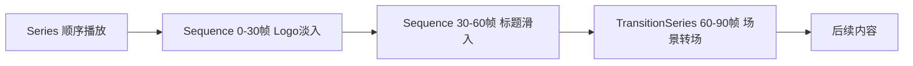

# 第12章 Remotion：用 React 制作视频

**本章概述**：Remotion 是一个用 React 编写视频的框架，核心思想是“把视频抽象为一棵组件树，每一帧画面都由 React 组件渲染出来”。本章我们学习 Remotion 的核心模型（Composition、帧、useCurrentFrame）、插值与弹簧动画（interpolate、spring）、序列与转场（Sequence、Series、TransitionSeries）、媒体与字幕以及渲染输出（renderMedia、@remotion/lambda）。

**读者对象**：你已经读完了第1–11章，掌握了 React 组件、状态、Hooks 的基础。如果你以前没做过视频制作，没关系，Remotion 让你用熟悉的 JSX 和 CSS 就能做出动态视频，不需要学习复杂的视频编辑软件。

---

## 12.1 Remotion 的核心模型：帧、Composition 与 useCurrentFrame

### Remotion 的核心思想

Remotion 的核心思想是“用 React 写视频”。视频在 Remotion 里被抽象为一棵组件树，一个 `<Composition>` 代表一段可渲染的视频，帧率、分辨率、时长都通过配置声明，每一帧画面都由组件渲染出来。

这带来两个普通剪辑软件很难给到的优势：
1. **视频内容与数据解耦**：你可以把字幕、背景图、音频路径放进一个 JSON 文件，同一套代码渲染出不同内容的视频；
2. **代码复用**：React 组件可以复用，动画逻辑可以封装成 Hook。

### 帧号驱动：所有动画必须由帧号驱动

Remotion 给开发者一个**帧号**（frame number）和一块画布。组件内通过 `useCurrentFrame()` 获取当前帧，**所有动画必须由帧号驱动**。CSS 动画和 `setTimeout` 会导致渲染伪影，被明确禁止——因为 Remotion 是逐帧渲染，不是连续时间轴，CSS 动画的时间点与帧号不同步，会导致闪烁或跳帧。

```tsx
// src/MyComponent.tsx
import { Composition, useCurrentFrame, AbsoluteFill } from 'remotion'

export const MyComposition = () => {
  return (
    <Composition
      id="MyComposition"
      component={MyVideo}
      durationInFrames={120}  // 视频总帧数
      fps={30}                // 帧率
      width={1920}
      height={1080}
    />
  )
}

export const MyVideo = () => {
  const frame = useCurrentFrame()  // 当前帧号，0 到 119
  return (
    <AbsoluteFill>
      <div>当前帧：{frame}</div>
    </AbsoluteFill>
  )
}
```

### 核心组件/函数

| API | 作用 |
|-----|------|
| `<Composition>` | 声明视频的宽、高、帧率、时长（帧数） |
| `useCurrentFrame()` | 获取当前帧号，所有动画由此驱动 |
| `<AbsoluteFill>` | 占据整个画布的容器，方便绝对定位 |

### 代码示例：一个简单的视频组件

```tsx
// src/HelloWorld.tsx
import { Composition, useCurrentFrame, AbsoluteFill } from 'remotion'

export const HelloWorld = () => {
  return (
    <Composition
      id="HelloWorld"
      component={HelloWorldFrame}
      durationInFrames={90}
      fps={30}
      width={1920}
      height={1080}
    />
  )
}

export const HelloWorldFrame = () => {
  const frame = useCurrentFrame()
  const progress = frame / 90  // 0 到 1 的进度

  return (
    <AbsoluteFill style={{ display: 'flex', flexDirection: 'column', alignItems: 'center', justifyContent: 'center' }}>
      <div style={{ fontSize: 48, color: '#333' }}>
        帧号：{frame}
      </div>
      <div style={{ fontSize: 24, color: '#666', marginTop: 16 }}>
        进度：{(progress * 100).toFixed(0)}%
      </div>
    </AbsoluteFill>
  )
}
```

> **小结**：Remotion 给开发者一个帧号和一块画布。`<Composition>` 声明视频的 `width`、`height`、`fps`、`durationInFrames`；组件内通过 `useCurrentFrame()` 获取当前帧，所有动画必须由帧号驱动，CSS 动画和 `setTimeout` 会导致渲染伪影，被明确禁止。

#### 帧号驱动的渲染模型

```mermaid
flowchart LR
    A[Composition 声明 fps/durationInFrames] --> B[Remotion 逐帧渲染]
    B --> C[useCurrentFrame() 返回当前帧号]
    C --> D[组件根据帧号计算样式/位置]
    D --> E[生成当前帧画面]
    E --> F[所有帧合成 MP4 视频]
    style F fill:#99ff99,stroke:#333
```

---

## 12.2 插值与弹簧动画：interpolate 与 spring

### interpolate：帧号到数值的映射

`interpolate(frame, inputRange, outputRange, { extrapolateRight: 'clamp' })` 是 Remotion 最基础的动画原语。它把当前帧号映射到一个输出数值范围，常用于透明度、位移、缩放等属性的渐变。

```tsx
import { interpolate, useCurrentFrame } from 'remotion'

const frame = useCurrentFrame()
// 帧 0-30，透明度从 0 到 1
const opacity = interpolate(frame, [0, 30], [0, 1])
// 帧 30-60，横向位移从 0 到 200px
const translateX = interpolate(frame, [30, 60], [0, 200])
```

`extrapolateRight: 'clamp'` 表示超出范围后保持边界值，不会继续变化。

### spring：物理感的入场动画

`spring({ frame, fps })` 提供基于弹簧物理模型的动画值，适合入场动画，比线性插值更有“手感”。

```tsx
import { spring, useCurrentFrame } from 'remotion'

const frame = useCurrentFrame()
const springValue = spring({ frame, fps: 30 }) // 帧 0 开始的弹簧动画
```

### 代码示例：淡入 + 缩放 + 弹簧滑入

```tsx
// src/AnimatedScene.tsx
import { useCurrentFrame, interpolate, spring, Absolutefill } from 'remotion'

export const AnimatedScene = () => {
  const frame = useCurrentFrame()

  // 淡入：帧 0-30，透明度 0 -> 1
  const opacity = interpolate(frame, [0, 30], [0, 1], {
    extrapolateRight: 'clamp',
  })

  // 缩放：帧 30-60，缩放 0.8 -> 1
  const scale = interpolate(frame, [30, 60], [0.8, 1], {
    extrapolateRight: 'clamp',
  })

  // 弹簧滑入：从左侧滑入
  const x = spring({ frame, fps: 30 })

  return (
    <Absolutefill
      style={{
        opacity,
        transform: [
          { translateX: x },
          { scale },
        ],
      }}
    >
      <div>动画内容</div>
    </Absolutefill>
  )
}
```

### 核心 API

| API | 作用 |
|-----|------|
| `interpolate(frame, inputRange, outputRange, config)` | 帧号到数值的线性映射 |
| `spring({ frame, fps })` | 基于弹簧物理模型的动画值 |
| `Easing` | 缓动函数，可配合 interpolate 使用 |

> **小结**：`interpolate` 是 Remotion 最基础的动画原语，把帧号映射到输出数值范围；`spring` 提供物理感的入场动画。两者配合可以实现淡入、缩放、滑入等常见动画效果。

#### 插值与弹簧动画原理

```mermaid
flowchart LR
    A[useCurrentFrame() 帧号] --> B[interpolate 线性映射]
    A --> C[spring 弹簧物理模型]
    B --> D[opacity / scale / translateX 数值]
    C --> D
    D --> E[组件样式变化]
    E --> F[帧画面渲染]
```

---

## 12.3 序列、转场与多场景组织

### Sequence：组织时间轴上的场景

`<Sequence from={} durationInFrames={}>` 组织时间轴上的场景，每个 Sequence 有自己的开始帧和持续帧数，可以嵌套。

### Series：顺序播放

`<Series>` 顺序播放子场景，适合串联多个片段。

### TransitionSeries：场景过渡

`<TransitionSeries>` 配合 `fade()` / `slide()` / `wipe()` 实现场景过渡，制作平滑的片头和片尾。

### 代码示例：三段式片头

```tsx
// src/Intro.tsx
import {
  Sequence,
  Series,
  TransitionSeries,
  fade,
  slide,
  useCurrentFrame,
} from 'remotion'

export const Intro = () => {
  return (
    <Series>
      {/* 第一段：Logo 淡入 */}
      <Sequence from={0} durationInFrames={30}>
        <div style={{ opacity: interpolate(useCurrentFrame(), [0, 30], [0, 1]) }}>
          Logo
        </div>
      </Sequence>

      {/* 第二段：标题滑入 */}
      <Sequence from={30} durationInFrames={30}>
        <div
          style={{
            transform: `translateX(${interpolate(useCurrentFrame(), [30, 60], [100, 0])}px)`,
          }}
        >
          欢迎观看
        </div>
      </Sequence>

      {/* 第三段：场景转场 */}
      <TransitionSeries from={60} durationInFrames={30}>
        {fade()}
      </TransitionSeries>
    </Series>
  )
}
```

### 核心 API

| API | 作用 |
|-----|------|
| `<Sequence from={} durationInFrames={}>` | 组织时间轴上的单个场景 |
| `<Series>` | 顺序播放多个场景 |
| `<TransitionSeries>` | 配合 fade/slide/wipe 实现场景过渡 |
| `fade()` / `slide()` / `wipe()` | 预设的过渡动画 |

> **小结**：`<Sequence>` 组织时间轴上的场景，`<Series>` 顺序播放，`<TransitionSeries>` 配合 `fade()` / `slide()` / `wipe()` 实现场景过渡。三段式片头（Logo 淡入 → 标题滑入 → 转场）是 Remotion 时间轴编排的典型模式。

#### 序列与转场时间轴



---

## 12.4 媒体、字幕与渲染输出

### 媒体组件

`<Audio>` / `<Video>` 从 `@remotion/media` 导入，本地资源用 `staticFile()`；`` 和 `<AnimatedImage>` 替代原生标签，确保在逐帧渲染中正确加载。

```tsx
import { Audio, Video, Img, staticFile } from '@remotion/media'
import { Img as RemotionImg } from 'remotion'

export const MediaScene = () => {
  return (
    <div>
      
      <Audio src={staticFile('background.mp3')} />
    </div>
  )
}
```

### 字幕

字幕通过 `createTikTokStyleCaptions()` 生成 token 级高亮，适合短视频字幕效果。

```tsx
import { createTikTokStyleCaptions } from '@remotion/captions'

const captions = createTikTokStyleCaptions([
  { text: '你好', start: 0, end: 30 },
  { text: '欢迎观看', start: 30, end: 60 },
])
```

### 渲染输出

输出使用 `@remotion/renderer` 的 `renderMedia()` 进行本地渲染，或使用 `@remotion/lambda` 在 AWS Lambda 上并行渲染。

```tsx
// src/render.ts
import { renderMedia } from '@remotion/renderer'
import { HelloWorld } from './HelloWorld'

renderMedia({
  composition: 'HelloWorld',
  codec: 'h264',
  inputDir: path.join(__dirname),
  outputLocation: path.join(__dirname, 'out.mp4'),
  props: {},
  imageFormat: 'jpeg',
  concurrency: 2,
})
```

### 核心 API

| API | 作用 |
|-----|------|
| `<Audio>` / `<Video>` | 音频/视频媒体 |
| `` / `<AnimatedImage>` | 图片组件 |
| `staticFile()` | 引用本地静态资源 |
| `createTikTokStyleCaptions()` | 生成 token 级高亮字幕 |
| `renderMedia()` | 本地渲染输出 MP4 |
| `@remotion/lambda` | AWS Lambda 并行云渲染 |

> **小结**：`<Audio>` / `<Video>` 从 `@remotion/media` 导入，本地资源用 `staticFile()`；`` 和 `<AnimatedImage>` 替代原生标签。字幕通过 `createTikTokStyleCaptions()` 生成 token 级高亮。输出使用 `@remotion/renderer` 的 `renderMedia()`，或 AWS Lambda 并行渲染。

#### 视频渲染输出流程

```mermaid
flowchart LR
    A[React 组件] --> B[Remotion 逐帧渲染]
    B --> C[所有帧图像]
    C --> D[renderMedia 合成 MP4]
    D --> E[输出视频文件]
    F[@remotion/lambda AWS Lambda] -->|并行渲染| E
```

---

## 本章小结

本章我们学习了 Remotion 用 React 制作视频的核心：

1. **核心模型**：`<Composition>` 声明视频参数（宽、高、帧率、时长），`useCurrentFrame()` 获取当前帧号，所有动画必须由帧号驱动，CSS 动画和 `setTimeout` 被禁止。
2. **插值与弹簧动画**：`interpolate` 把帧号映射到数值范围，`spring` 提供物理感的入场动画。
3. **序列与转场**：`<Sequence>` 组织场景，`<Series>` 顺序播放，`<TransitionSeries>` 配合 `fade`/`slide`/`wipe` 做场景过渡。
4. **媒体与字幕**：`<Audio>`/`<Video>`/`` 处理媒体，`staticFile()` 引用本地资源，`createTikTokStyleCaptions()` 生成字幕。
5. **渲染输出**：`renderMedia()` 本地渲染 MP4，`@remotion/lambda` 支持 AWS Lambda 并行云渲染。

下一章是 React 游戏开发，学习 PixiJS 2D 游戏和 React Three Fiber 3D 游戏。