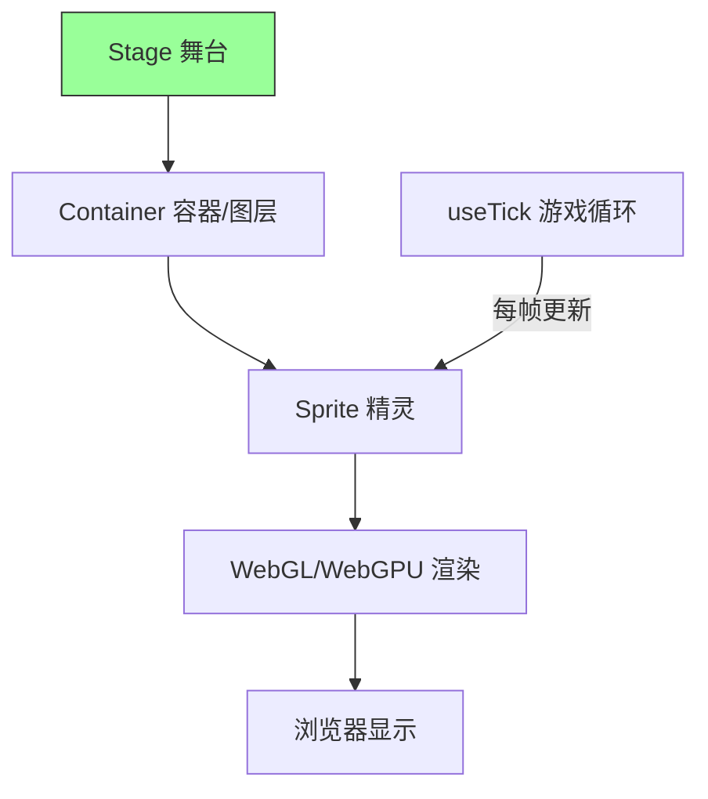
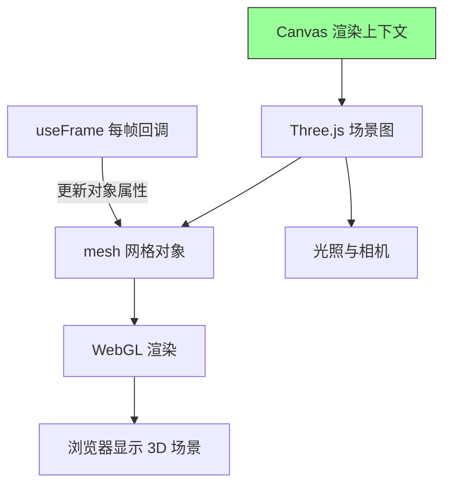
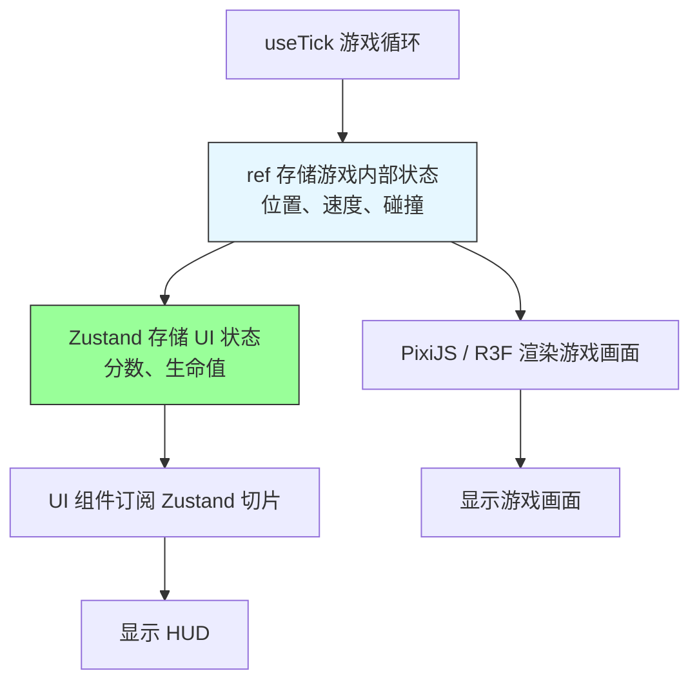
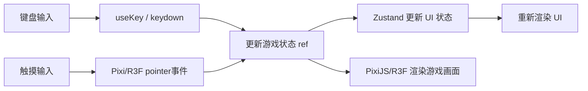

# 第13章 React 游戏开发

**本章概述**：React 不仅能做网页和移动端，还能做游戏。本章我们学习 React 游戏开发的两个主要方向：2D 游戏用 PixiJS + `@pixi/react`，3D 游戏用 React Three Fiber。接着学习游戏状态管理与 60FPS 优化，最后学习输入处理与移动端适配。

**读者对象**：你已经读完了第1–12章，掌握了 React 组件、状态、Hooks 的基础，也做过 Web 和移动端项目。如果你以前没做过游戏开发，没关系，我们从最简单的精灵移动和场景搭建开始，一步步讲清楚。

---

## 13.1 2D 游戏：React + PixiJS

### 什么是 PixiJS？

PixiJS 是一个高性能的 2D WebGL/WebGPU 渲染引擎，专门用于浏览器中的 2D 图形和游戏渲染。它比原生 Canvas API 更高级，提供了精灵（Sprite）、容器（Container）、纹理（Texture）、舞台（Stage）等概念，适合做 2D 游戏和交互式动画。

**`@pixi/react`** 是 PixiJS 的 React 封装层，它将精灵、容器、纹理映射为 React 组件，让你用熟悉的 JSX 语法组织游戏对象。

### 核心组件

| 组件 | 作用 |
|------|------|
| `<Stage>` | 挂载 PixiJS 画布，是整个游戏的根容器 |
| `<Sprite>` | 渲染精灵图，游戏中的角色、物品等 |
| `<Container>` | 组织图层，可以嵌套，用于分组管理游戏对象 |
| `useTick` | 驱动逐帧更新，游戏循环的核心 |

### 代码示例：横向卷轴移动的精灵

```tsx
// src/game/SpriteScene.tsx
import { Stage, Sprite, Container, useTick } from '@pixi/react'
import { Texture } from 'pixi.js'
import { useRef, useState } from 'react'

export const SpriteScene = () => {
  const [position, setPosition] = useState({ x: 100, y: 300 })

  // 游戏循环：每帧更新精灵位置
  useTick((delta) => {
    setPosition((prev) => ({
      x: prev.x + 2, // 每帧向右移动 2 像素
      y: prev.y,
    }))
  })

  return (
    <Stage width={800} height={600} backgroundColor={0x87ceeb}>
      <Container>
        <Sprite
          texture={Texture.from('ship.png')}
          x={position.x}
          y={position.y}
        />
      </Container>
    </Stage>
  )
}
```

### requestAnimationFrame 与 React 渲染循环的协同

PixiJS 自带的渲染循环基于 `requestAnimationFrame`，`useTick` Hook 封装了这个循环，每帧调用一次回调。React 渲染循环和 PixiJS 渲染循环是分离的：`useTick` 里的状态更新如果触发 React 重渲染，可能会影响性能，所以游戏内部状态建议放在 `ref` 中，只把需要显示的 UI 状态同步到 React 状态。

> **小结**：PixiJS 提供高性能 2D WebGL/WebGPU 渲染，`@pixi/react` 将精灵、容器、纹理映射为 React 组件。`<Stage>` 挂载画布，`<Sprite>` 渲染精灵，`<Container>` 组织图层，`useTick` 驱动逐帧更新。`requestAnimationFrame` 与 React 渲染循环协同，游戏内部状态放 `ref` 中，避免每帧触发 React 重渲染。

#### PixiJS 渲染架构



---

## 13.2 3D 游戏：React Three Fiber

### 什么是 React Three Fiber？

`@react-three/fiber`（简称 R3F）是 React 对 Three.js 的 React 封装，它将 Three.js 的场景图映射为 React 组件树。你可以用 `<Canvas>`、`<mesh>`、`<boxGeometry>`、`<meshStandardMaterial>` 等组件声明式地构建 3D 场景，`useFrame` 驱动逐帧更新。

R3F 不能 SSR（服务端渲染），因为 Three.js 需要浏览器的 WebGL 上下文，需要用 `dynamic(import('R3F'))` 动态导入。Three.js 会引入较大的 chunk，需要路由级代码分割，避免首屈加载过大。

### 核心组件/Hook

| API | 作用 |
|-----|------|
| `<Canvas>` | Three.js 渲染上下文的声明式代理，3D 场景的根 |
| `useFrame` | 每帧执行的回调，驱动 3D 对象动画 |
| `useThree` | 获取 Three.js 的相机、场景、渲染器等上下文 |
| `<OrbitControls>` | `@react-three/drei` 提供的轨道控制器，支持旋转、缩放 |
| `useTexture` | 加载 3D 模型的纹理 |

### 代码示例：一个旋转的 3D 立方体

```tsx
// src/game/CubeScene.tsx
import { Canvas, useFrame } from '@react-three/fiber'
import { useRef } from 'react'
import { OrbitControls } from '@react-three/drei'

export const CubeScene = () => {
  const meshRef = useRef<any>(null)

  // 每帧让立方体旋转
  useFrame((state, delta) => {
    meshRef.current.rotation.x += 0.01
    meshRef.current.rotation.y += 0.01
  })

  return (
    <Canvas>
      <OrbitControls />
      <ambientLight intensity={0.5} />
      <pointLight position={[10, 10, 10]} />
      <mesh ref={meshRef} position={[0, 0, 0]}>
        <boxGeometry args={[1, 1, 1]} />
        <meshStandardMaterial color="hotpink" />
      </mesh>
    </Canvas>
  )
}
```

### 注意事项

- **不能 SSR**：R3F 依赖浏览器 WebGL，服务端渲染会报错，需要动态导入；
- **包体积大**：Three.js 体积较大，建议配合路由级懒加载（`React.lazy` + `Suspense` 或 React Router 的 `route.lazy`）；
- **性能**：3D 渲染消耗 GPU，复杂场景需要注意 draw call 数量和几何体复杂度。

> **小结**：`@react-three/fiber` 将 Three.js 的场景图映射为 React 组件树，`useFrame` 驱动逐帧更新。R3F 不能 SSR，需动态导入；Three.js 包体积大，需路由级代码分割。`<Canvas>`、`useFrame`、`useThree` 是核心 API，`@react-three/drei` 提供 `OrbitControls` 等辅助组件。

#### React Three Fiber 渲染架构



---

## 13.3 游戏状态管理与 60FPS 优化

### 游戏状态管理

简单游戏（如打砖块、简单射击）用 `useState`/`useReducer` 足够；复杂游戏引入 Zustand 管理玩家、敌人、分数等全局游戏状态。

```tsx
// src/game/store.ts
import { create } from 'zustand'

interface GameState {
  score: number
  lives: number
  playerPosition: { x: number; y: number }
  enemies: Array<{ id: string; x: number; y: number }>
  addScore: (points: number) => void
  loseLife: () => void
  setPlayerPosition: (x: number, y: number) => void
}

export const useGameStore = create<GameState>((set) => ({
  score: 0,
  lives: 3,
  playerPosition: { x: 400, y: 300 },
  enemies: [],

  addScore: (points) => set((state) => ({ score: state.score + points })),
  loseLife: () => set((state) => ({ lives: state.lives - 1 })),
  setPlayerPosition: (x, y) => set({ playerPosition: { x, y } }),
}))
```

### 60FPS 优化的关键：最小化 React 重渲染

60FPS 意味着每秒渲染 60 帧，每帧只有约 16.6ms。如果每帧都触发 React 组件重渲染，会严重影响性能。

**关键原则：**

1. **游戏循环状态放在 `ref` 中**：位置、速度、碰撞状态等每帧变化的数据，用 `useRef` 存储，不触发 React 重渲染；
2. **跨帧 UI 状态放在 Zustand**：分数、生命值、游戏结束等需要显示在 UI 上的状态，放在 Zustand 中，组件通过选择器订阅；
3. **重计算用 `useMemo`**：碰撞检测、路径计算等耗时计算用 `useMemo` 缓存；
4. **后台计算移入 Web Worker**：复杂的物理计算、AI 逻辑可移到 Web Worker，避免阻塞主线程。

```tsx
// 优化后的游戏循环
export const GameLoop = () => {
  const { score, lives } = useGameStore((state) => ({
    score: state.score,
    lives: state.lives,
  }))

  // 游戏内部状态放 ref，不触发 React 重渲染
  const playerRef = useRef({ x: 400, y: 300, vx: 0, vy: 0 })
  const enemiesRef = useRef([])

  useTick((delta) => {
    // 每帧更新 ref 状态，不触发 React 重渲染
    playerRef.current.x += playerRef.current.vx * delta
    // ...碰撞检测、敌人移动等
  })

  // 只渲染需要显示的 UI 分数和生命值
  return (
    <div>
      <div>分数：{score}</div>
      <div>生命：{lives}</div>
      <Stage>{/* PixiJS 或 R3F 渲染游戏画面 */}</Stage>
    </div>
  )
}
```

### 核心 API

| API | 作用 |
|-----|------|
| `zustand` | 游戏全局状态（分数、生命值、敌人列表） |
| `useRef` | 存储每帧变化的游戏内部状态，不触发重渲染 |
| `useMemo` | 缓存碰撞检测等耗时计算 |
| `useCallback` | 缓存事件处理函数 |
| Web Worker | 后台物理计算，避免阻塞主线程 |
| Howler.js | 游戏音效播放 |

> **小结**：简单游戏用 `useState`/`useReducer`，复杂游戏引入 Zustand 管理全局游戏状态。60FPS 的关键是最小化 React 重渲染：游戏循环状态放在 `ref` 中，跨帧 UI 状态放在 Zustand，重计算用 `useMemo`，后台计算移入 Web Worker。

#### 游戏状态与渲染分离



---

## 13.4 输入处理与移动端适配

### 输入方式

| 输入方式 | 实现方式 | 适用场景 |
|---------|---------|---------|
| 键盘 | `useKey`（rooks）或原生 `keydown`/`keyup` | PC 端游戏 |
| 触摸 | Pixi/R3F 的事件系统，或 `touch` 事件 | 移动端游戏 |
| 虚拟摇杆 | 自定义 `VirtualJoystick` 组件 | 移动端动作类游戏 |

### 键盘输入

```tsx
import { useKey } from 'rooks'

export const KeyboardInput = () => {
  useKey('ArrowLeft', () => {
    // 向左移动
  })
  useKey('ArrowRight', () => {
    // 向右移动
  })
  useKey(' ', () => {
    // 射击
  })

  return null
}
```

### 触摸输入

PixiJS 和 R3F 都有自己的事件系统，可以直接给精灵或 3D 对象绑定 `pointerdown`、`pointermove` 等事件：

```tsx
<Sprite
  texture={Texture.from('ship.png')}
  onPointerDown={() => {
    // 触摸精灵时触发
  }}
/>
```

### Retina 屏与 devicePixelRatio

移动端 Retina 屏的设备像素比（devicePixelRatio）可能大于 1，需要显式处理，否则图像会模糊。PixiJS 的 `<Application>` 可以配置 `resolution`，R3F 的 `<Canvas>` 也可以通过 `dpr` 属性设置。

```tsx
<Stage resolution={window.devicePixelRatio} />
// 或
<Canvas dpr={window.devicePixelRatio} />
```

### 内存泄漏清理

`useEffect` 或 `useTick` 里的事件监听器、定时器、动画循环，组件卸载时必须清理，否则会造成内存泄漏。

```tsx
useTick((delta) => {
  // 游戏逻辑
}, [])

// 组件卸载时，useTick 会自动清理，无需额外处理
// 但如果自己添加了 window 事件监听，需要在 useEffect 清理函数中移除
```

> **小结**：键盘用 `useKey`（rooks）或原生 `keydown`/`keyup`，触摸用 Pixi/R3F 的事件系统或 `touch` 事件。`devicePixelRatio` 需要显式处理 Retina 屏，`useEffect` 清理必须严格避免内存泄漏。

#### 输入处理流程



---

## 本章小结

本章我们学习了 React 游戏开发：

1. **2D 游戏：React + PixiJS**：PixiJS 提供高性能 2D 渲染，`@pixi/react` 将精灵、容器、纹理映射为 React 组件。`<Stage>`、`<Sprite>`、`<Container>`、`useTick` 是核心 API。`requestAnimationFrame` 与 React 渲染循环协同，游戏内部状态放 `ref` 中。
2. **3D 游戏：React Three Fiber**：`@react-three/fiber` 将 Three.js 场景图映射为 React 组件树，`useFrame` 驱动逐帧更新。R3F 不能 SSR，需动态导入；Three.js 包体积大，需路由级代码分割。`<Canvas>`、`useFrame`、`useThree` 是核心 API，`@react-three/drei` 提供辅助组件。
3. **游戏状态管理与 60FPS 优化**：简单游戏用 `useState`/`useReducer`，复杂游戏用 Zustand。60FPS 关键是最小化 React 重渲染：游戏循环状态放 `ref`，跨帧 UI 状态放 Zustand，重计算用 `useMemo`，后台计算移入 Web Worker。
4. **输入处理与移动端适配**：键盘用 `useKey`，触摸用 Pixi/R3F 事件系统，`devicePixelRatio` 需显式处理，`useEffect` 清理避免内存泄漏。

下一章是项目实战四：游戏项目，把第13章的 2D/3D 渲染知识收束为一个可玩的太空射击游戏。