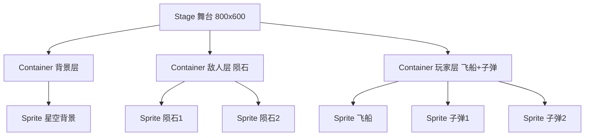
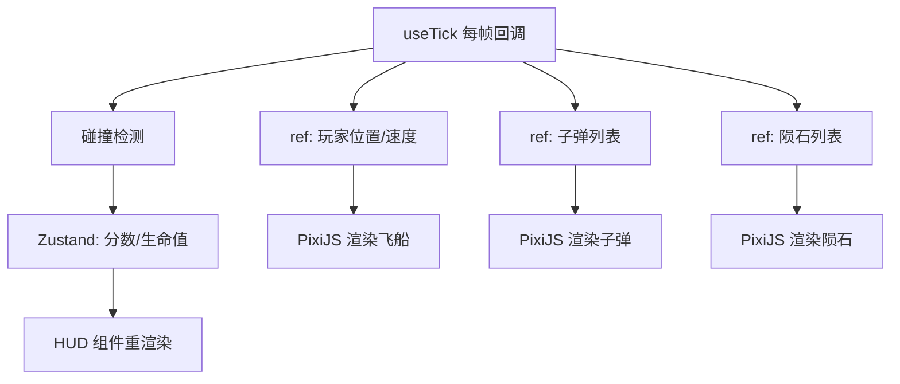
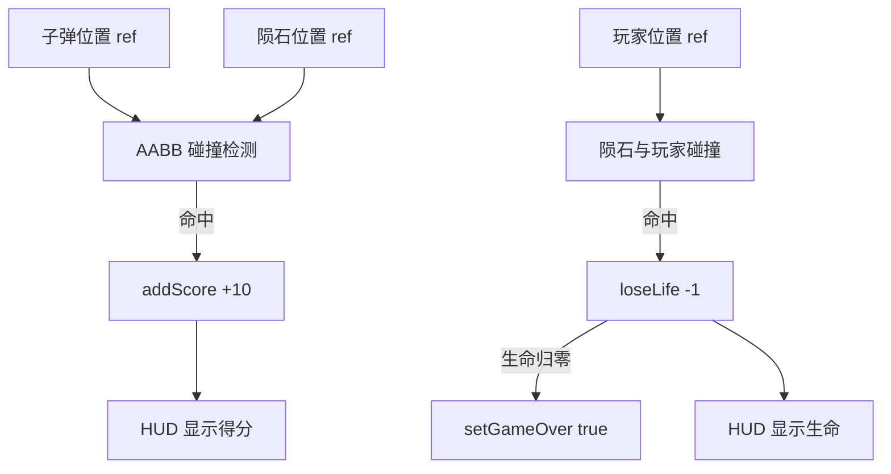
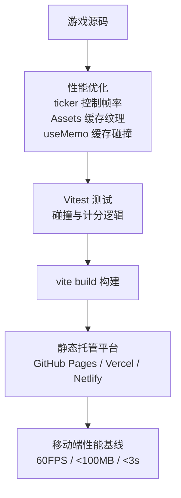

# 第14章 项目实战四：游戏项目

**本章概述**：本章把第13章的 2D/3D 渲染知识收束为一个可玩的完整游戏。选题为**太空射击游戏（StarDrift）**：PixiJS 渲染 2D 场景、Zustand 管理游戏状态、Howler.js 处理音效、支持键盘与触摸双端操作。我们会从游戏设计与技术选型开始，逐步搭建 Stage、Sprite 与场景、useTick 游戏循环与状态更新、碰撞检测与得分生命值系统、音效与键盘触摸双端输入，最后做性能优化、测试与发布。

**读者对象**：你已经读完了第1–13章，掌握了 React 组件、状态、Hooks、路由、网络、测试，以及 PixiJS 2D 渲染和 React Three Fiber 3D 渲染的基础。本章是把游戏开发知识串联起来的第四个完整项目。

---

## 14.1 游戏设计与技术选型

### 游戏选题：StarDrift 太空射击游戏

StarDrift 是一个 2D 太空射击游戏，核心玩法：

- 玩家控制飞船左右移动，自动或手动射击
- 屏幕顶部不断生成陨石，向下移动
- 子弹击中陨石得分，陨石撞到飞船扣生命值
- 随着时间推移，难度递增（陨石速度加快、生成频率变高）
- 生命值归零后游戏结束，可重新开始

### 技术选型

| 模块 | 技术选型 | 理由 |
|------|---------|------|
| 渲染 | `@pixi/react` + `pixi.js` | 2D 射击游戏用 PixiJS 更轻，不需要 Three.js 的 3D 能力 |
| 状态管理 | Zustand | 轻量，支持选择器订阅，适合游戏分数、生命值、敌人列表 |
| 音效 | Howler.js | 成熟的 Web 音频库，支持 preload、volume、音频解锁 |
| 构建 | Vite | 启动快，构建产物静态化，易部署 |

### 为什么不用 R3F？

2D 射击游戏不需要三维空间、光照、相机等 3D 特性，PixiJS 的 2D 渲染更轻量，包体积更小，性能更好。R3F 适合需要 3D 模型、光照、材质的 3D 游戏，StarDrift 这种 2D 射击游戏用 PixiJS 足够。

> **小结**：StarDrift 太空射击游戏采用 `@pixi/react` 渲染、`zustand` 管状态、`howler` 管音效、`Vite` 构建。不用 R3F 是因为 2D 射击不需要 3D 能力，PixiJS 更轻量。

#### 技术选型对照

```mermaid
flowchart TD
    A[StarDrift 太空射击] --> B[@pixi/react + pixi.js<br/>2D 渲染]
    A --> C[zustand<br/>游戏状态]
    A --> D[howler.js<br/>音效]
    A --> E[Vite<br/>构建]
    style B fill:#99ff99,stroke:#333
    style C fill:#99ff99,stroke:#333
```

---

## 14.2 Stage、Sprite 与场景搭建

### 用 <Stage> 挂载画布

`<Stage>` 是 PixiJS 的 React 封装，负责创建 WebGL 渲染上下文和画布，是整个游戏的根容器。

```tsx
// src/game/StarDrift.tsx
import { Stage, Sprite, Container, Assets, Application } from '@pixi/react'

export const StarDrift = () => {
  return (
    <Stage
      width={800}
      height={600}
      backgroundColor={0x000011}
      resolution={window.devicePixelRatio}
      autoDensity={true}
    >
      {/* 游戏场景内容在这里渲染 */}
    </Stage>
  )
}
```

`resolution` 设置为 `window.devicePixelRatio` 可以处理 Retina 屏，避免图像模糊；`autoDensity` 自动调整画布大小。

### 用 <Sprite> 渲染飞船与陨石

纹理预加载用 `Assets.load`，渲染用 `<Sprite>`。

```tsx
// 资源预加载
await Assets.load([
  { alias: 'ship', src: '/assets/ship.png' },
  { alias: 'asteroid', src: '/assets/asteroid.png' },
  { alias: 'bullet', src: '/assets/bullet.png' },
])

// 渲染精灵
<Sprite texture={Assets.get('ship')} x={400} y={500} />
<Sprite texture={Assets.get('asteroid')} x={200} y={100} />
```

### 用 <Container> 组织图层

`<Container>` 可以嵌套，用于分组管理游戏对象。比如把所有陨石放在一个 Container 里，把所有子弹放在另一个 Container 里，统一控制显隐和位置。

```tsx
<Container>
  {/* 背景星空 */}
  <Sprite texture={Assets.get('starfield')} />
</Container>
<Container>
  {/* 敌人层：陨石 */}
  {asteroids.map((a) => (
    <Sprite key={a.id} texture={Assets.get('asteroid')} x={a.x} y={a.y} />
  ))}
</Container>
<Container>
  {/* 玩家层：飞船和子弹 */}
  <Sprite texture={Assets.get('ship')} x={player.x} y={player.y} />
  {bullets.map((b) => (
    <Sprite key={b.id} texture={Assets.get('bullet')} x={b.x} y={b.y} />
  ))}
</Container>
```

> **小结**：用 `<Stage>` 挂载画布，配置 `resolution` 和 `autoDensity` 处理 Retina 屏；用 `<Sprite>` 渲染飞船与陨石，纹理通过 `Assets.load` 预加载；用 `<Container>` 组织图层，分层管理背景、敌人、玩家。

#### 场景图层结构



---

## 14.3 useTick 游戏循环与状态更新

### 用 useTick 驱动逐帧更新

`useTick` 是 `@pixi/react` 提供的 Hook，每帧调用一次回调，是游戏循环的核心。

```tsx
// src/game/GameLoop.tsx
import { useTick } from '@pixi/react'
import { useRef } from 'react'
import { useGameStore } from '@/store/useGameStore'

export const GameLoop = () => {
  const { score, lives, setScore, setLives, setGameOver } = useGameStore()
  const playerRef = useRef({ x: 400, y: 500, speed: 5 })
  const asteroidsRef = useRef([])
  const bulletsRef = useRef([])
  const frameRef = useRef(0)

  useTick((delta) => {
    frameRef.current++

    // 1. 移动玩家飞船（根据输入状态）
    // ...玩家移动逻辑

    // 2. 移动子弹
    bulletsRef.current.forEach((b) => {
      b.y -= b.speed
    })

    // 3. 移动陨石
    asteroidsRef.current.forEach((a) => {
      a.y += a.speed
    })

    // 4. 生成新陨石（难度随时间递增）
    if (frameRef.current % Math.max(20, 60 - score / 10) === 0) {
      asteroidsRef.current.push({
        id: crypto.randomUUID(),
        x: Math.random() * 800,
        y: -50,
        speed: 2 + score / 100,
      })
    }

    // 5. 碰撞检测
    checkCollisions(bulletsRef.current, asteroidsRef.current, playerRef.current)

    // 6. 清理超出屏幕的对象
    bulletsRef.current = bulletsRef.current.filter((b) => b.y > -10)
    asteroidsRef.current = asteroidsRef.current.filter((a) => a.y < 650)
  })

  return null // 游戏循环不渲染 UI，只驱动状态更新
}
```

### 关键原则：帧内状态放 ref，跨帧 UI 状态放 Zustand

- **帧内状态（位置、速度、碰撞）**：放在 `useRef` 中，每帧更新不触发 React 重渲染，保证 60FPS；
- **跨帧 UI 状态（分数、生命值、游戏结束）**：放在 Zustand，组件通过选择器订阅，只有状态变化才重渲染 UI。

```tsx
// UI 组件只渲染分数和生命值
export const HUD = () => {
  const { score, lives } = useGameStore((state) => ({
    score: state.score,
    lives: state.lives,
  }))

  return (
    <div className="hud">
      <div>分数：{score}</div>
      <div>生命：{lives}</div>
    </div>
  )
}
```

> **小结**：`useTick` 驱动逐帧更新，移动飞船、生成陨石、计算碰撞。关键原则是帧内状态放 `ref`，跨帧 UI 状态放 Zustand，避免每帧触发 React 重渲染。

#### 游戏循环与状态分离



---

## 14.4 碰撞检测、得分与生命值系统

### 用 AABB 包围盒做碰撞检测

AABB（Axis-Aligned Bounding Box，轴对齐包围盒）是 2D 游戏中最简单的碰撞检测算法：两个矩形的水平和垂直范围都重叠，就判定为碰撞。

```tsx
// src/game/collision.ts
export const checkCollision = (a: { x: number; y: number; w: number; h: number }, b: { x: number; y: number; w: number; h: number }) => {
  return (
    a.x < b.x + b.w &&
    a.x + a.w > b.x &&
    a.y < b.y + b.h &&
    a.y + a.h > b.y
  )
}
```

### 碰撞逻辑

```tsx
// src/game/checkCollisions.ts
import { useGameStore } from '@/store/useGameStore'

export const checkCollisions = (bullets: any[], asteroids: any[], player: any) => {
  const { addScore, loseLife, setGameOver } = useGameStore.getState()

  // 子弹与陨石碰撞
  bullets.forEach((b) => {
    asteroids.forEach((a) => {
      if (checkCollision(b, a)) {
        addScore(10) // 击中得分
        // 移除子弹和陨石
        b.markedForRemoval = true
        a.markedForRemoval = true
      }
    })
  })

  // 陨石与玩家碰撞
  asteroids.forEach((a) => {
    if (checkCollision(a, player)) {
      loseLife() // 扣除生命值
      a.markedForRemoval = true
      if (/* 生命值归零 */) {
        setGameOver(true)
      }
    }
  })
}
```

### 得分与生命值系统

得分和生命值存储在 Zustand 中，HUD 组件通过选择器订阅，只有数值变化才重渲染。

```tsx
// src/store/useGameStore.ts
import { create } from 'zustand'

export const useGameStore = create<{
  score: number
  lives: number
  gameOver: boolean
  addScore: (points: number) => void
  loseLife: () => void
  setGameOver: (over: boolean) => void
  reset: () => void
}>((set) => ({
  score: 0,
  lives: 3,
  gameOver: false,

  addScore: (points) => set((state) => ({ score: state.score + points })),
  loseLife: () => set((state) => ({ lives: state.lives - 1 })),
  setGameOver: (over) => set({ gameOver: over }),
  reset: () => set({ score: 0, lives: 3, gameOver: false }),
}))
```

> **小结**：用 AABB 包围盒做碰撞检测，命中后减少生命值、播放爆炸动画；得分用 Zustand 管理并在 HUD 组件中订阅切片。游戏逻辑与渲染分离，便于测试。

#### 碰撞检测与得分流程



---

## 14.5 音效、键盘与触摸双端输入

### 音效：Howler.js

Howler.js 是成熟的 Web 音频库，支持 preload、volume、音频解锁（用户首次交互后才能播放音频，这是浏览器的安全策略）。

```tsx
// src/game/sound.ts
import Howl from 'howler'

export const shootSound = new Howl({
  src: ['/assets/shoot.mp3'],
  volume: 0.5,
})

export const explosionSound = new Howl({
  src: ['/assets/explosion.mp3'],
  volume: 0.7,
})

export const gameOverSound = new Howl({
  src: ['/assets/gameover.mp3'],
  volume: 0.8,
})

// 播放音效
export const playShoot = () => shootSound.play()
export const playExplosion = () => explosionSound.play()
export const playGameOver = () => gameOverSound.play()
```

### 键盘输入：useKey（rooks）

```tsx
// src/game/KeyboardInput.tsx
import { useKey } from 'rooks'
import { useGameStore } from '@/store/useGameStore'

export const KeyboardInput = () => {
  const { setPlayerPosition } = useGameStore()

  useKey('ArrowLeft', () => {
    setPlayerPosition((prev) => ({ x: prev.x - 5, y: prev.y }))
  })

  useKey('ArrowRight', () => {
    setPlayerPosition((prev) => ({ x: prev.x + 5, y: prev.y }))
  })

  useKey(' ', () => {
    // 发射子弹
    playShoot()
  })

  return null
}
```

### 触摸输入：Pixi 的 pointerdown 事件

```tsx
<Sprite
  texture={Assets.get('ship')}
  x={player.x}
  y={player.y}
  onPointerDown={(e) => {
    // 触摸飞船，可开火或移动
    playShoot()
  }}
  onPointerMove={(e) => {
    // 拖拽飞船
  }}
/>
```

### 移动端虚拟摇杆

移动端没有物理键盘，需要渲染一个虚拟摇杆组件：

```tsx
// src/game/VirtualJoystick.tsx
export const VirtualJoystick = () => {
  // 渲染一个圆形的摇杆背景和可拖拽的摇杆头
  // 触摸拖拽时，更新玩家移动方向
  return (
    <View className="joystick">
      <View className="joystick-bg" />
      <View className="joystick-knob" />
    </View>
  )
}
```

### 音频解锁策略

浏览器禁止在用户首次交互前自动播放音频。Howler.js 需要在用户第一次点击屏幕或按键后，才能正常播放音效。可以在游戏开始按钮的点击事件里初始化音频上下文。

> **小结**：用 Howler.js 播放射击/爆炸音效，`useKey` 处理键盘输入，Pixi 的 `pointerdown` 处理触摸，移动端渲染虚拟摇杆。音频需要在用户首次交互后才能播放，这是浏览器的音频解锁策略。

#### 双端输入流程

```mermaid
flowchart TD
    A[键盘: ArrowLeft/Right/Space] --> B[useKey rooks]
    C[触摸: pointerdown/move] --> D[Pixi 事件系统]
    E[移动端: 虚拟摇杆] --> D
    B --> F[更新玩家位置 ref]
    D --> F
    F --> G[射击: playShoot()]
    G --> H[Howler.js 播放音效]
```

---

## 14.6 性能优化、测试与发布

### 性能优化

| 优化点 | 做法 |
|--------|------|
| 帧率控制 | 用 Pixi 的 `ticker` 控制帧率，避免过高帧率浪费性能 |
| 纹理缓存 | 用 `Assets` 缓存纹理，避免重复加载 |
| 碰撞计算缓存 | 用 `useMemo` 缓存碰撞检测结果 |
| 游戏状态分离 | 帧内状态放 `ref`，UI 状态放 Zustand，避免每帧重渲染 |

```tsx
// 纹理预加载与缓存
await Assets.load({
  ship: '/assets/ship.png',
  asteroid: '/assets/asteroid.png',
})

// 碰撞检测用 useMemo 缓存
const collisions = useMemo(() => {
  return computeCollisions(bullets, asteroids, player)
}, [bullets, asteroids, player])
```

### 测试：Vitest 测试碰撞与计分逻辑

碰撞检测和计分是纯函数，很容易测试：

```tsx
// src/game/collision.test.ts
import { checkCollision } from './collision'

test('AABB 碰撞检测：两个矩形重叠返回 true', () => {
  const a = { x: 0, y: 0, w: 50, h: 50 }
  const b = { x: 25, y: 25, w: 50, h: 50 }
  expect(checkCollision(a, b)).toBe(true)
})

test('AABB 碰撞检测：两个矩形不重叠返回 false', () => {
  const a = { x: 0, y: 0, w: 50, h: 50 }
  const b = { x: 100, y: 100, w: 50, h: 50 }
  expect(checkCollision(a, b)).toBe(false)
})
```

### 发布：vite build 部署

```bash
npm run build
```

`vite build` 会把游戏编译成静态文件（HTML、CSS、JS、资源），可以部署到任何静态托管平台（GitHub Pages、Vercel、Netlify 等）。

### 移动端性能基线

| 指标 | 基线 |
|------|------|
| 帧率 | 60FPS |
| 内存占用 | < 100MB |
| 首屈加载 | < 3 秒 |

> **小结**：用 Pixi 的 `ticker` 控制帧率，`Assets` 缓存纹理，`useMemo` 缓存碰撞计算，游戏状态分离避免每帧重渲染。用 Vitest 测试碰撞与计分逻辑（纯函数易测）。最终 `vite build` 部署，移动端性能基线是 60FPS、内存占用 < 100MB、首屈加载 < 3 秒。

#### 性能优化与发布流程



---

## 本章小结

第14章是第四个完整项目实战，我们构建了 StarDrift 太空射击游戏：

1. **游戏设计与技术选型**：飞船射击陨石、分数与生命值、难度递增、游戏结束重开。技术栈：`@pixi/react` 渲染、`zustand` 管状态、`howler` 管音效、`Vite` 构建。不用 R3F 是因为 2D 射击不需要 3D 能力。
2. **Stage、Sprite 与场景搭建**：`<Stage>` 挂载画布，`<Sprite>` 渲染飞船与陨石，`<Container>` 组织图层，`Assets.load` 预加载纹理。
3. **useTick 游戏循环与状态更新**：每帧移动飞船、子弹、陨石，生成新陨石，碰撞检测。帧内状态放 `ref`，跨帧 UI 状态放 Zustand。
4. **碰撞检测、得分与生命值系统**：AABB 包围盒碰撞检测，命中后加分/扣血，Zustand 管理分数和生命值。
5. **音效、键盘与触摸双端输入**：Howler.js 播放音效，`useKey` 处理键盘，Pixi `pointerdown` 处理触摸，移动端虚拟摇杆，音频解锁策略。
6. **性能优化、测试与发布**：`ticker` 控制帧率，`Assets` 缓存纹理，`useMemo` 缓存碰撞，Vitest 测试纯函数逻辑，`vite build` 部署到静态托管平台。

至此，本书的 15 章正文已全部完成。第15章是插件、工程化与发布，收束工程化与发布知识。