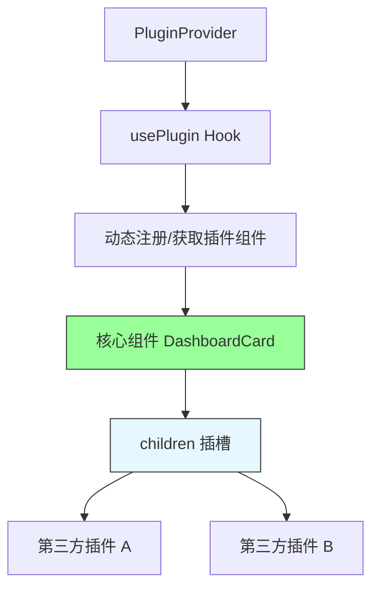
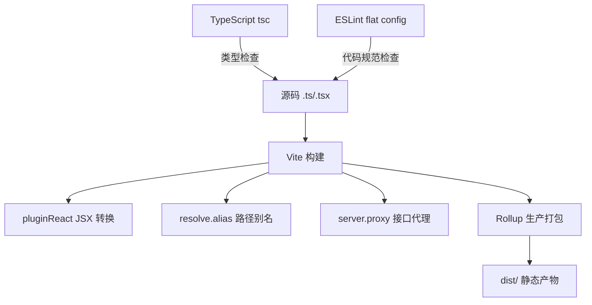
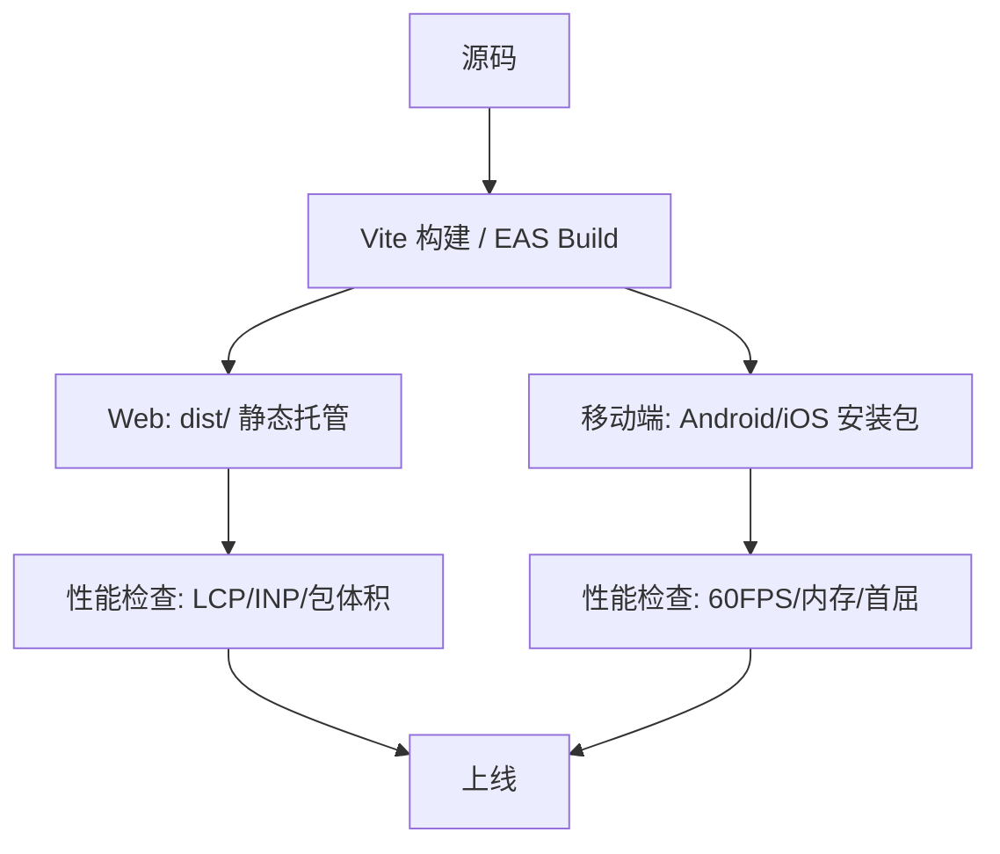
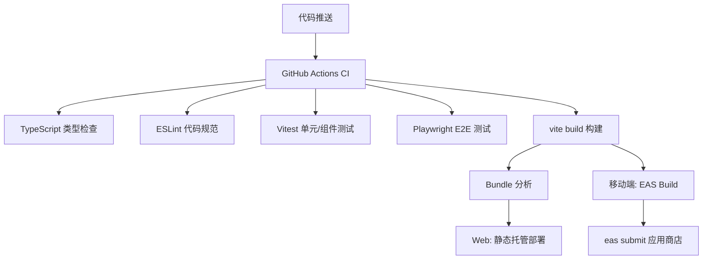

# 第15章 插件、工程化与发布

**本章概述**：本章承接前面所有章节的知识，讲解 React 插件化架构、构建工具链深入、发布与性能基线、持续集成与持续部署。我们会学习如何用组合模式和插槽设计可扩展的插件系统、深入 Vite 配置、TypeScript 严格模式与 ESLint flat config、Web 端和移动端的发布差异、CI/CD 工作流骨架，并汇总四个实战项目的部署差异。

**读者对象**：你已经读完了第1–14章，完成了四个实战项目（SPA、多页面后台、移动端应用、太空射击游戏）。本章是把工程化与发布知识收束的最后一章，帮助你把项目从“能跑”提升到“可维护、可发布、可持续演进”。

---

## 15.1 React 插件化架构：组合模式与插槽

### React 的“插件”通常表现为组合模式

React 本身没有内置的“插件系统”概念，但它的组合模式天然适合做插件化架构。通过 `children`、render props 或 Context 注入扩展点，第三方代码可以在不修改核心组件的前提下注入 UI 与行为。

你可以把核心组件想象成一个“宿主”，插件是插入宿主的“扩展模块”。宿主定义好插槽（slot），插件把自己的内容填进插槽。

### 三种插槽实现方式

#### 1. children 组合（最简单）

```tsx
// src/components/DashboardCard.tsx
import { Card, CardContent, CardHeader } from '@/components/ui'

interface DashboardCardProps {
  title: string
  children: React.ReactNode  // 插槽：第三方内容填到这里
}

export function DashboardCard({ title, children }: DashboardCardProps) {
  return (
    <Card>
      <CardHeader>{title}</CardHeader>
      <CardContent>{children}</CardContent>
    </Card>
  )
}

// 使用：第三方插件把自己的组件放进 children
<DashboardCard title="实时监控">
  <PluginA />  {/* 插件 A */}
  <PluginB />  {/* 插件 B */}
</DashboardCard>
```

#### 2. render props（更灵活）

```tsx
// src/components/PluginHost.tsx
interface PluginHostProps {
  data: PluginData
  renderPlugin: (data: PluginData) => React.ReactNode  // 渲染插件的函数
}

export function PluginHost({ data, renderPlugin }: PluginHostProps) {
  return (
    <div className="plugin-host">
      {renderPlugin(data)}
    </div>
  )
}

// 使用：插件通过 render props 控制渲染逻辑
<PluginHost data={pluginData} renderPlugin={(data) => <CustomChart data={data} />} />
```

#### 3. createContext + 自定义 usePlugin Hook（适合复杂插件系统）

```tsx
// src/context/PluginContext.tsx
import { createContext, useContext, useCallback } from 'react'

interface PluginContextValue {
  registerPlugin: (name: string, component: React.ComponentType) => void
  getPlugin: (name: string) => React.ComponentType | undefined
}

const PluginContext = createContext<PluginContextValue | undefined>(undefined)

export function PluginProvider({ children }: { children: React.ReactNode }) {
  const [plugins, setPlugins] = useState<Map<string, React.ComponentType>>(new Map())

  const registerPlugin = useCallback((name: string, component: React.ComponentType) => {
    setPlugins((prev) => new Map(prev).set(name, component))
  }, [])

  const getPlugin = useCallback((name: string) => {
    return plugins.get(name)
  }, [plugins])

  return (
    <PluginContext.Provider value={{ registerPlugin, getPlugin }}>
      {children}
    </PluginContext.Provider>
  )
}

export const usePlugin = () => {
  const context = useContext(PluginContext)
  if (!context) {
    throw new Error('usePlugin 必须在 PluginProvider 内部使用')
  }
  return context
}
```

### 代码示例：可扩展的 Dashboard 卡片系统

```tsx
// src/components/Dashboard.tsx
import { DashboardCard } from './DashboardCard'
import { usePlugin } from '@/context/PluginContext'

export function Dashboard() {
  const { getPlugin } = usePlugin()

  // 动态获取注册的插件组件
  const WeatherWidget = getPlugin('weather')
  const NewsWidget = getPlugin('news')
  const StockWidget = getPlugin('stock')

  return (
    <div className="dashboard">
      <DashboardCard title="天气">
        {WeatherWidget ? <WeatherWidget /> : <div>暂无天气插件</div>}
      </DashboardCard>
      <DashboardCard title="新闻">
        {NewsWidget ? <NewsWidget /> : <div>暂无新闻插件</div>}
      </DashboardCard>
      <DashboardCard title="股票">
        {StockWidget ? <StockWidget /> : <div>暂无股票插件</div>}
      </DashboardCard>
    </div>
  )
}
```

第三方插件注册：

```tsx
// src/plugins/weather.tsx
import { PluginProvider } from '@/context/PluginContext'
import { WeatherWidget } from './WeatherWidget'

// 在应用初始化时注册插件
PluginProvider.registerPlugin('weather', WeatherWidget)
```

> **小结**：React 的“插件”通常表现为组合模式。通过 `children`、render props 或 `createContext` + 自定义 `usePlugin` Hook 注入扩展点，第三方代码可以在不修改核心组件的前提下注入 UI 与行为。`children` 最简单，`render props` 更灵活，Context + Hook 适合复杂插件系统。

#### 插件化架构



---

## 15.2 构建工具链：Vite 配置、TypeScript 与 ESLint

### Vite 配置深入

承接第1章的 Vite 初始化，这里深入 `vite.config.ts` 的 React 插件、别名、代理与环境变量。

```ts
// vite.config.ts
import { defineConfig } from 'vite'
import { pluginReact } from '@vitejs/plugin-react'
import path from 'path'

export default defineConfig({
  plugins: [pluginReact()],
  resolve: {
    alias: {
      '@': path.resolve(__dirname, './src'),
      '@components': path.resolve(__dirname, './src/components'),
      '@features': path.resolve(__dirname, './src/features'),
    },
  },
  server: {
    proxy: {
      '/api': {
        target: 'http://localhost:3000',
        changeOrigin: true,
      },
    },
  },
})
```

- `pluginReact()`：Vite 的 React 插件，负责 JSX 转换和 Fast Refresh；
- `resolve.alias`：路径别名，避免深层相对路径；
- `server.proxy`：开发环境接口代理，避免跨域问题。

### TypeScript 配置

```json
// tsconfig.json
{
  "compilerOptions": {
    "target": "ES2022",
    "lib": ["ES2022", "DOM", "DOM.Iterable"],
    "module": "ESNext",
    "moduleResolution": "bundler",
    "strict": true,
    "noEmit": true,
    "jsx": "react-jsx",
    "verbatimModuleSyntax": true,
    "allowImportingTsExtensions": true,
    "resolveJsonModule": true,
    "isolatedModules": true,
    "paths": {
      "@/*": ["./src/*"]
    }
  },
  "include": ["src"],
  "references": [{ "path": "./tsconfig.node.json" }]
}
```

- `strict`：开启所有严格类型检查，包括 `noImplicitAny`、`strictNullChecks` 等；
- `verbatimModuleSyntax`：要求使用 `import type` 导入类型，避免类型和值混淆；
- `isolatedModules`：适用于 Vite 等构建工具，确保每个文件可以独立编译。

### ESLint flat config

ESLint 已经迁移到 flat config（`eslint.config.js`），不再使用 `.eslintrc`。

```js
// eslint.config.js
import js from '@eslint/js'
import tseslint from 'typescript-eslint'
import reactPlugin from 'eslint-plugin-react'
import reactHooksPlugin from 'eslint-plugin-react-hooks'
import reactRefreshPlugin from 'eslint-plugin-react-refresh'

export default tseslint.config(
  js.configs.recommended,
  ...tseslint.configs.recommended,
  {
    files: ['**/*.{ts,tsx}'],
    plugins: {
      react: reactPlugin,
      'react-hooks': reactHooksPlugin,
      'react-refresh': reactRefreshPlugin,
    },
    rules: {
      ...reactPlugin.configs.recommended.rules,
      'react-hooks/rules-of-hooks': 'error',
      'react-hooks/exhaustive-deps': 'warn',
      'react-refresh/only-export-components': [
        'warn',
        { allowConstantExport: true },
      ],
    },
  }
)
```

- `eslint-plugin-react-hooks` 的 `rules-of-hooks`：强制 Hooks 调用规则；
- `eslint-plugin-react-refresh` 的 `only-export-components`：配合 Fast Refresh，只导出组件；
- TypeScript ESLint：类型感知的 lint 规则。

> **小结**：Vite 配置深入 React 插件、路径别名、接口代理；TypeScript 开启 `strict` 与 `verbatimModuleSyntax`；ESLint flat config 集成 React Hooks 规则与 React Refresh 规则，保证代码质量。

#### 构建工具链



---

## 15.3 发布与性能基线

### Web 端发布

Web 端关注路由级代码分割与 bundle 分析。

```tsx
// 路由级懒加载
const ProductList = React.lazy(() => import('./pages/ProductList'))

<Suspense fallback={<div>加载中...</div>}>
  <ProductList />
</Suspense>
```

```ts
// vite.config.ts 代码分割
build: {
  rollupOptions: {
    output: {
      manualChunks: {
        vendor: ['react', 'react-dom'],
        antd: ['antd'],
        router: ['react-router-dom'],
      },
    },
  },
},
```

### 移动端发布

移动端用 EAS Build 构建与分发：

```bash
# 构建 Android
npx eas build --platform android

# 构建 iOS
npx eas build --platform ios

# 提交到应用商店
npx eas submit
```

### 性能检查清单

上线前的性能检查清单：

| 检查项 | Web 端 | 移动端 |
|--------|--------|--------|
| LCP（最大内容绘制） | < 2.5s | - |
| INP（交互到下次绘制） | < 200ms | - |
| 包体积 | 主 bundle < 200KB gzip | - |
| R3F/Three.js 懒加载 | 路由级分割 | - |
| 帧率 | - | 60FPS |
| 内存占用 | - | < 100MB |
| 首屈加载 | < 3s | < 3s |

### 四个实战项目的部署差异

| 项目 | 部署方式 | 关键配置 |
|------|---------|---------|
| 第8章 SPA（TaskFlow） | 静态托管（Vercel/Netlify） | `vite build` → `dist/` |
| 第9章 多页面后台（ShopAdmin） | 静态托管 | `vite build` + 路由历史记录模式 |
| 第11章 移动端（HabitLoop） | EAS Build → 应用商店 | `eas build` → `eas submit` |
| 第14章 游戏（StarDrift） | 静态托管 | `vite build` → `dist/` |

> **小结**：Web 端关注路由级代码分割与 bundle 分析，移动端用 EAS Build 构建与分发。性能检查清单包括 LCP、INP、包体积阈值、R3F/Three.js 懒加载策略。四个实战项目的部署差异：Web 端都用静态托管，移动端走 EAS Build 分发。

#### 发布与性能基线



---

## 15.4 持续集成与持续部署

### CI 工作流骨架

CI 中串联第7章的测试套件、15.2 的 lint 与类型检查、15.3 的构建与体积分析。

```yaml
# .github/workflows/ci.yml
name: CI

on:
  push:
    branches: [master]
  pull_request:
    branches: [master]

jobs:
  test-and-build:
    runs-on: ubuntu-latest
    steps:
      - uses: actions/checkout@v4

      - name: 安装依赖
        uses: actions/setup-node@v4
        with:
          node-version: '20'
          cache: 'npm'
        run: npm ci

      - name: 类型检查
        run: npx tsc --noEmit

      - name: Lint 检查
        run: npm run lint

      - name: 单元与组件测试
        run: npm run test -- --coverage

      - name: E2E 测试
        uses: cypress-io/github-action@v6
        with:
          build: npm run build
          start: npm run preview

      - name: 构建
        run: npm run build

      - name: Bundle 分析
        run: npx rollup-plugin-visualizer
```

### 部署

- Web 端部署到静态托管或边缘平台（Vercel、Netlify、GitHub Pages、阿里云 OSS + CDN）；
- 移动端走 EAS Build 分发到 Google Play / App Store。

### 四个项目复用同一套 CI 配置

四个实战项目（TaskFlow、ShopAdmin、HabitLoop、StarDrift）都可以复用同一套 GitHub Actions 工作流配置，只需在各自项目的仓库中启用该 Workflow，并根据项目类型调整构建命令（`npm run build` 对 Web 项目，`npx eas build` 对移动端项目）。

> **小结**：CI 中串联测试套件、lint 与类型检查、构建与体积分析；Web 端部署到静态托管或边缘平台，移动端走 EAS Build 分发。四个实战项目可复用同一套 CI 配置。

#### CI/CD 流程



---

## 本章小结

本章我们学习了插件、工程化与发布：

1. **React 插件化架构**：组合模式是 React 插件化的基础，通过 `children`、render props 或 `createContext` + `usePlugin` Hook 注入扩展点，第三方代码可在不修改核心组件的前提下注入 UI 与行为。
2. **构建工具链**：Vite 配置深入 React 插件、路径别名、接口代理；TypeScript 开启 `strict` 与 `verbatimModuleSyntax`；ESLint flat config 集成 React Hooks 规则与 React Refresh 规则。
3. **发布与性能基线**：Web 端关注路由级代码分割与 bundle 分析，移动端用 EAS Build 构建与分发。性能检查清单包括 LCP、INP、包体积、帧率、内存占用。四个实战项目的部署差异：Web 端静态托管，移动端 EAS Build。
4. **持续集成与持续部署**：CI 中串联测试、lint、类型检查、构建与体积分析；四个实战项目可复用同一套 GitHub Actions 工作流。

至此，本书全部 15 章正文已完成。从第1章的 React 核心组件与渲染模型，到第15章的插件、工程化与发布，我们完整地走过了“从组件到移动端、视频与游戏”的全栈 React 开发旅程。